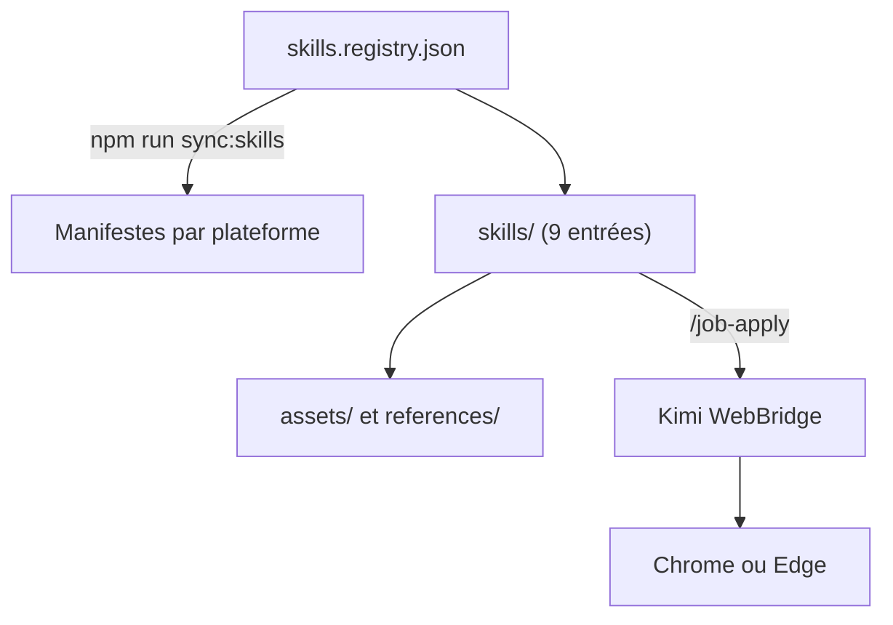

# Hisn00w/ASu-skills

> Plugin de neuf skills en chinois pour la recherche d'emploi : CV, entretiens, suivi de candidatures, contributions open source.

## Le problème
Le chercheur d'emploi doit enchaîner des tâches éparses : trouver des preuves d'expérience, adapter son CV à une offre, préparer ses entretiens et suivre ses candidatures.

## Ce que ça fait vraiment
Neuf commandes à appeler depuis Claude Code, Codex et d'autres hôtes : `/contributor` (contributions open source), `/evidence-recap`, `/project-guide`, `/great-resume`, `/make-resume` (HTML éditable, PDF, LaTeX), `/job-match`, `/job-apply` (remplit des formulaires via un navigateur), `/interview` et `/offer`. Le README insiste sur les faits réels et interdit l'invention d'expériences.

## Comment c'est branché

Schéma simplifié d'après la fiche, sans diagramme fourni.

## Essayer
```bash
/plugin marketplace add Hisn00w/ASu-skills
/plugin install asu-skills@asu
/reload-plugins
```

## Coût et pièges
Gratuit, licence MIT. `/job-apply` exige une extension de navigateur (Kimi WebBridge ou l'extension ChatGPT) et que tu fournisses tes identifiants et codes de vérification toi-même. Le README interdit l'envoi massif de candidatures.

## Ce que ce n'est pas
Ce n'est pas un outil d'IA ni de data : c'est un ensemble de prompts de coaching en chinois. Il ne garantit aucun résultat de recrutement.

## Alternatives
Le README cite SHUAMONE (jeu de révision pour postes IA) en complément, pas en remplacement.

## Pour toi
À ignorer : tout est en chinois et ciblé sur le recrutement en Chine, sans lien avec ton travail data ou MLOps.

