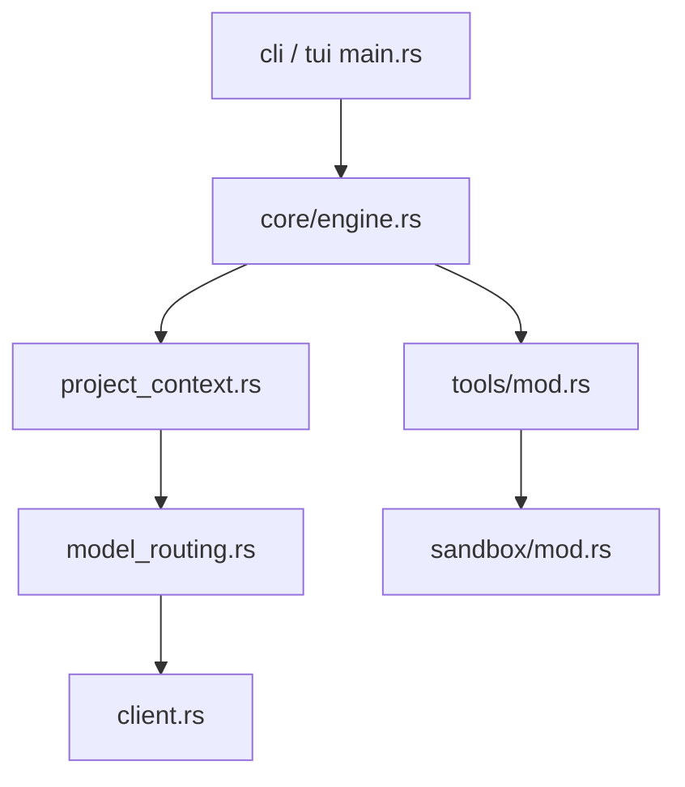

# Hmbown/CodeWhale

> Terminal coding agent, written in Rust, compatible with more than forty model providers.

## The problem
Coding agents are tied to one provider and leave few verifiable traces of their local actions.

## What it actually does
Same README as `Hmbown/DeepSeek-TUI` (same stars and dates: the renamed repository). An agent that edits, runs commands, logs through `/receipts`, undoes through `/undo`. Entry points: TUI, `exec`, `web`, execution API, ACP for editors. Feishu, Telegram and Weixin bridges, VS Code extension.

## How it is wired


## Trying it
```bash
curl -fsSL https://codewhale.net/install.sh | sh
codewhale
codewhale exec --auto --sandbox workspace-write "fix the failing tests and explain what changed"
```
Also: `npm install -g codewhale`, `cargo install codewhale-cli --locked`.

## Cost and gotchas
Provider API key at your expense, or a local model (Ollama, vLLM). Telemetry on by default. An OrcaRouter offer earns the author a commission.

## What it is not
Not a product distinct from `Hmbown/DeepSeek-TUI` according to the facts provided. Desktop application not available.

## Alternatives
No alternative named in the README.

## For you
Watch: same verdict as its twin; keep only one of the two repositories in the catalog.
