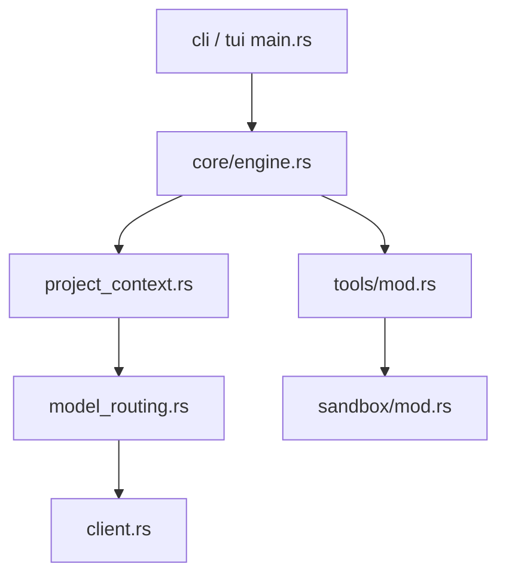

# Hmbown/CodeWhale

> Agent de code en terminal, en Rust, compatible avec plus de quarante fournisseurs de modèles.

## Le problème
Les agents de code sont liés à un fournisseur et laissent peu de traces vérifiables de leurs actions locales.

## Ce que ça fait vraiment
Même README que `Hmbown/DeepSeek-TUI` (mêmes étoiles et dates : le dépôt renommé). Agent qui édite, lance des commandes, journalise via `/receipts`, annule via `/undo`. Entrées : TUI, `exec`, `web`, API d'exécution, ACP pour éditeurs. Ponts Feishu, Telegram, Weixin, extension VS Code.

## Comment c'est branché


## Essayer
```bash
curl -fsSL https://codewhale.net/install.sh | sh
codewhale
codewhale exec --auto --sandbox workspace-write "fix the failing tests and explain what changed"
```
Aussi : `npm install -g codewhale`, `cargo install codewhale-cli --locked`.

## Coût et pièges
Clé d'API fournisseur à ta charge, ou modèle local (Ollama, vLLM). Télémétrie par défaut. Une offre OrcaRouter rapporte une commission à l'auteur.

## Ce que ce n'est pas
Pas un produit distinct de `Hmbown/DeepSeek-TUI` d'après les faits fournis. Application de bureau non disponible.

## Alternatives
Aucune alternative nommée dans le README.

## Pour toi
À surveiller : même verdict que son jumeau ; garder un seul des deux dépôts dans le catalogue.

