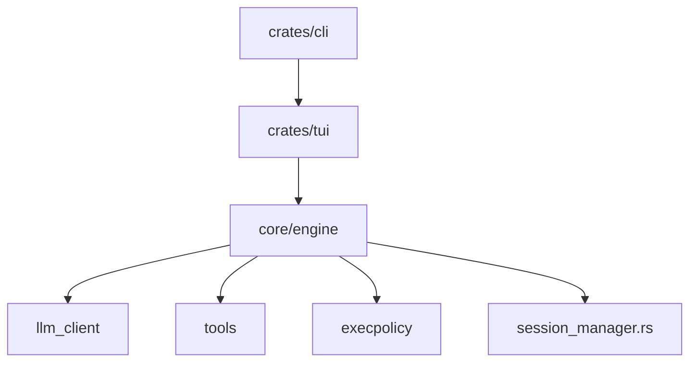

# Hmbown/DeepSeek-TUI

> Terminal coding agent, written in Rust, compatible with more than forty model providers.

## The problem
Coding agents are often tied to a single provider, with no clear trace of the files modified and the commands run.

## What it actually does
Reads the repository, edits files and runs commands. Plan, Work, Operate modes; Ask, Auto-Review, Full Access permissions. `/receipts` logs files, commands and web/MCP calls; `/undo` reverts the last request. Sub-agents, MCP, local execution API. The README describes the product under the name Codewhale.

## How it is wired


## Trying it
```bash
curl -fsSL https://codewhale.net/install.sh | sh
codewhale
codewhale exec --auto --sandbox workspace-write "fix the failing tests and explain what changed"
```

## Cost and gotchas
Free; provider API key at your expense (DeepSeek by default), or a local model. Telemetry enabled by default (`codewhale config set telemetry false`). `exec --auto` has no sandbox.

## What it is not
Not a simple DeepSeek client despite the repository name. No OS sandbox on Windows. Same content as `Hmbown/CodeWhale`.

## Alternatives
No alternative named in the README.

## For you
Watch: multi-provider coding agent with receipts useful for auditing, but a young project with a single maintainer, and telemetry to turn off.
