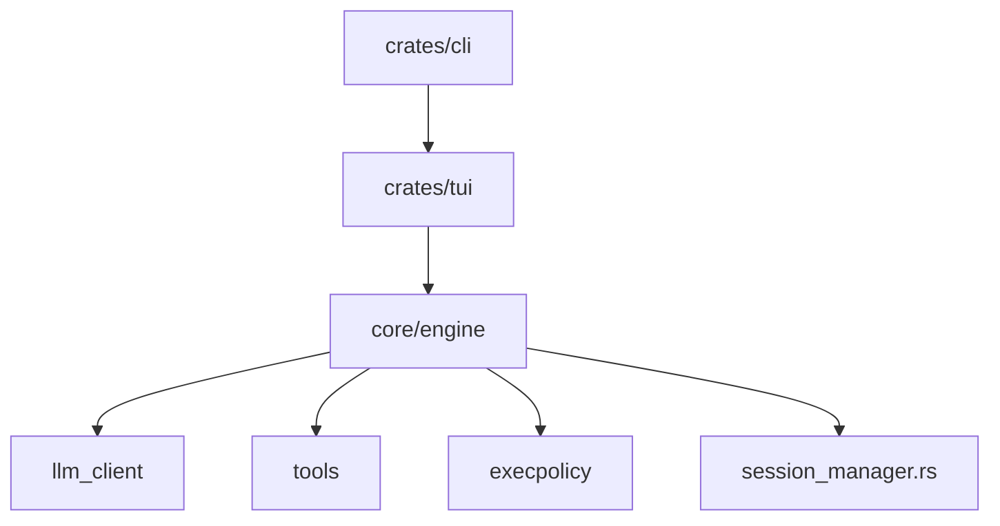

# Hmbown/DeepSeek-TUI

> Agent de code en terminal, en Rust, compatible avec plus de quarante fournisseurs de modèles.

## Le problème
Les agents de code sont souvent liés à un seul fournisseur, sans trace claire des fichiers modifiés et des commandes exécutées.

## Ce que ça fait vraiment
Lit le dépôt, modifie des fichiers et lance des commandes. Modes Plan, Work, Operate ; permissions Ask, Auto-Review, Full Access. `/receipts` journalise fichiers, commandes et appels web/MCP ; `/undo` annule la dernière requête. Sous-agents, MCP, API d'exécution locale. Le README décrit le produit sous le nom Codewhale.

## Comment c'est branché


## Essayer
```bash
curl -fsSL https://codewhale.net/install.sh | sh
codewhale
codewhale exec --auto --sandbox workspace-write "fix the failing tests and explain what changed"
```

## Coût et pièges
Gratuit ; clé d'API du fournisseur à ta charge (DeepSeek par défaut), ou modèle local. Télémétrie activée par défaut (`codewhale config set telemetry false`). `exec --auto` n'a pas de bac à sable.

## Ce que ce n'est pas
Pas un simple client DeepSeek malgré le nom du dépôt. Pas de sandbox OS sous Windows. Même contenu que `Hmbown/CodeWhale`.

## Alternatives
Aucune alternative nommée dans le README.

## Pour toi
À surveiller : agent de code multi-fournisseur avec reçus utiles à l'audit, mais projet jeune et mainteneur unique, télémétrie à couper.

