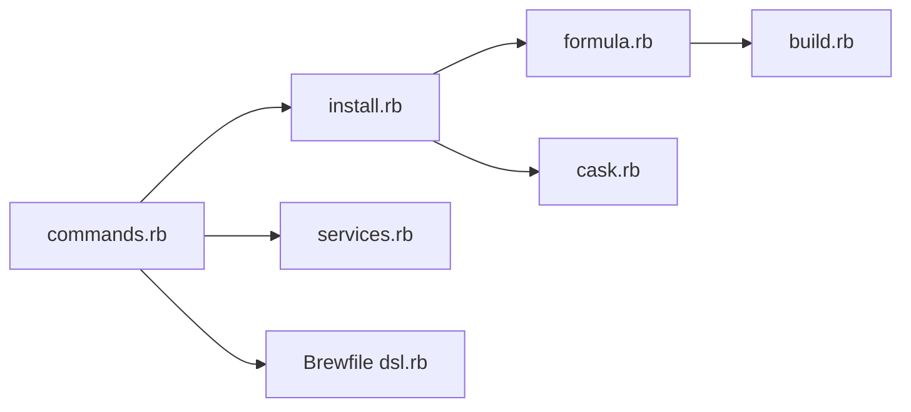

# Homebrew/brew

> Package manager for macOS and Linux: installs and updates formulae and casks.

## The problem
Installing command-line tools by hand means managing dependencies, paths and updates yourself.

## What it actually does
`brew` searches, installs and updates formulae and casks, with `brew bundle` to describe an environment and `brew services` to run services via launchd or systemd. Package metadata, audit and anonymous usage analytics. The README points to brew.sh for installation.

## How it is wired

## Trying it
No installation command in the README (it points to brew.sh). The only mentions are: `man brew`, `brew update`, `brew doctor`.

## Cost and gotchas
Free, funded by donations. Anonymous analytics are collected (see the project's dedicated page). It asks you to read `brew doctor` before asking for any help.

## What it is not
Not a Python environment manager nor a container tool. This repository is the code of `brew`, not formulae.

## Alternatives
No alternative named in the README.

## For you
Ignore here: you know it or not depending on your OS, and this repository brings no data/AI building block.
