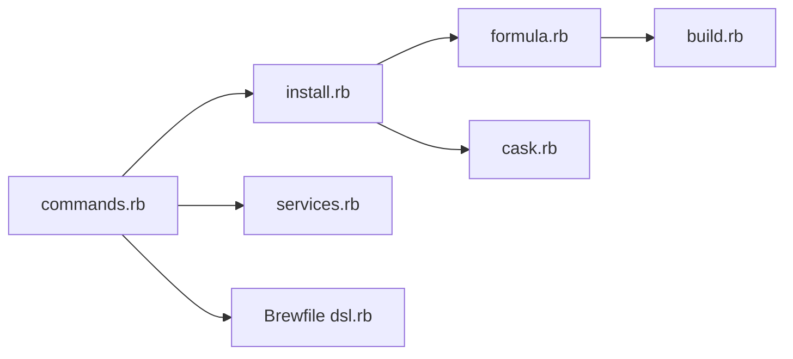

# Homebrew/brew

> Gestionnaire de paquets pour macOS et Linux : installe et met à jour formules et casks.

## Le problème
Installer des outils en ligne de commande à la main demande de gérer dépendances, chemins et mises à jour.

## Ce que ça fait vraiment
`brew` cherche, installe et met à jour des formules et des casks, avec `brew bundle` pour décrire un environnement et `brew services` pour lancer des services via launchd ou systemd. Métadonnées de paquets, audit et analytiques d'usage anonymes. Le README renvoie à brew.sh pour l'installation.

## Comment c'est branché

## Essayer
Aucune commande d'installation dans le README (il renvoie à brew.sh). Seules mentions : `man brew`, `brew update`, `brew doctor`.

## Coût et pièges
Gratuit, financé par dons. Des analytiques anonymes sont collectées (voir la page dédiée du projet). Demande de lire `brew doctor` avant toute demande d'aide.

## Ce que ce n'est pas
Pas un gestionnaire d'environnements Python ni un outil de conteneurs. Ce dépôt est le code de `brew`, pas des formules.

## Alternatives
Aucune alternative nommée dans le README.

## Pour toi
À ignorer ici : tu le connais ou non selon ton OS, ce dépôt n'apporte pas de brique data/IA.

