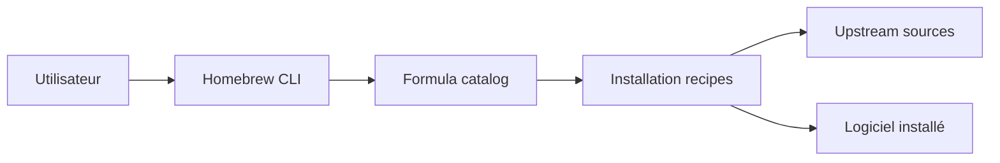

# Homebrew/homebrew-core

> Default catalogue of formulae for the Homebrew package manager, for macOS and Linux.

## The problem
Install command-line software along with its dependencies without compiling everything by hand.

## What it actually does
A repository of Ruby recipes (formulae): `brew install <name>` consults this catalogue, resolves dependencies, fetches the sources or a bottle, then runs the recipe. The README is minimal; Homebrew's runtime code is not here.

## How it is wired


## Trying it
```bash
brew install <formula>
```

## Cost and gotchas
Free, no prerequisites: it is the default tap, already installed with Homebrew. The README is too short to detail the rest: not documented.

## What it is not
Not Homebrew's engine: only its formulae. Not a repository where you deploy application code.

## Alternatives
No alternative named in the README.

## For you
Adopt: it is already the source of the CLI tools on your macOS or Linux machine; nothing more to evaluate.
