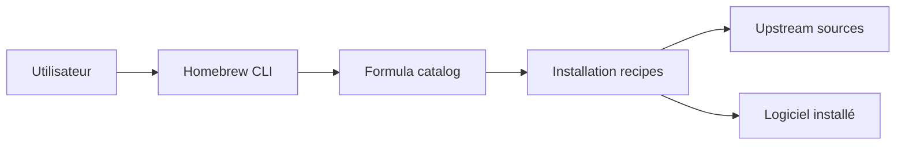

# Homebrew/homebrew-core

> Catalogue par défaut des formules du gestionnaire de paquets Homebrew, pour macOS et Linux.

## Le problème
Installer des logiciels en ligne de commande avec leurs dépendances sans tout compiler à la main.

## Ce que ça fait vraiment
Dépôt de recettes (formules) Ruby : `brew install <nom>` consulte ce catalogue, résout les dépendances, récupère les sources ou une bouteille, puis exécute la recette. Le README est minimal ; le code d'exécution de Homebrew n'est pas ici.

## Comment c'est branché


## Essayer
```bash
brew install <formula>
```

## Coût et pièges
Gratuit, aucun prérequis : c'est le tap par défaut, déjà installé avec Homebrew. README trop court pour détailler le reste : non documenté.

## Ce que ce n'est pas
Pas le moteur de Homebrew : seulement ses formules. Pas un dépôt où l'on déploie du code applicatif.

## Alternatives
Aucune alternative nommée dans le README.

## Pour toi
Adopter, c'est déjà la source des outils CLI de ton poste macOS ou Linux ; rien à évaluer de plus.

