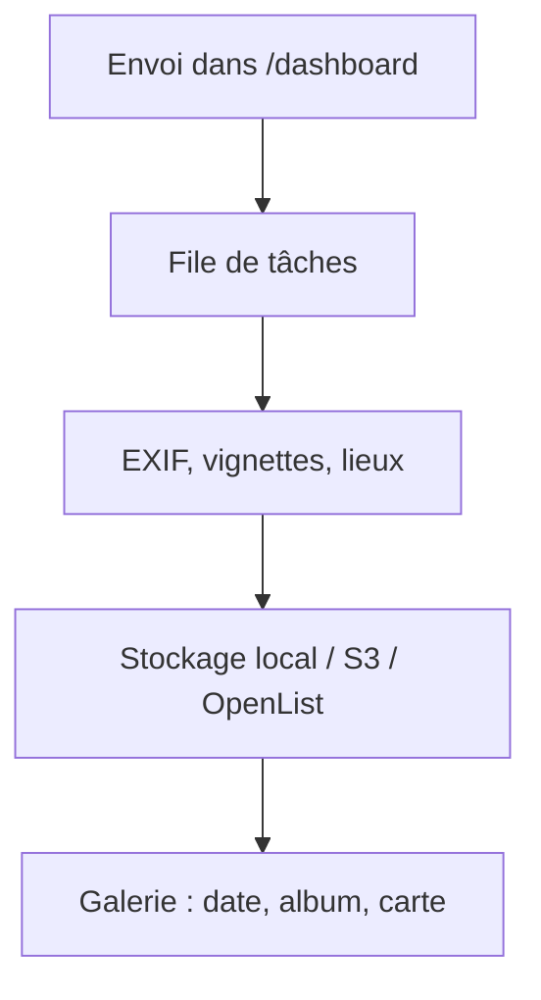

# HoshinoSuzumi/chronoframe

> Self-hosted photo gallery that extracts EXIF, generates previews, geolocates shots and reads Live Photos.

## The problem
Hosting your own photos with a map, albums and Live Photos without going through a cloud service.

## What it actually does
After upload, a task queue handles EXIF, thumbnails, reverse geocoding and image/video pairing. Browse by date, album or map (MapLibre/Mapbox), WebGL zoom, password-protected albums, local, S3 or OpenList storage, setup wizard, email or GitHub OAuth login.

## How it is wired
Simplified diagram based on the sheet, no diagram provided.


## Trying it
```bash
docker compose up -d
docker run -d --name chronoframe --restart unless-stopped \
  -p 3000:3000 -v "$(pwd)/data:/app/data" \
  ghcr.io/hoshinosuzumi/chronoframe:latest
```

## Cost and gotchas
Keep the ./data volume (database, secrets, photos). Use HTTPS for public exposure. A map token is optional. Protected albums do not protect public S3/CDN URLs.

## What it is not
Not an AI sorting tool. A paid cloud version may exist, pricing not specified. AGPL.

## Alternatives
No alternative named in the README.

## For you
Keep an eye on it: a clean personal gallery for a homelab, unrelated to your data/AI work.
