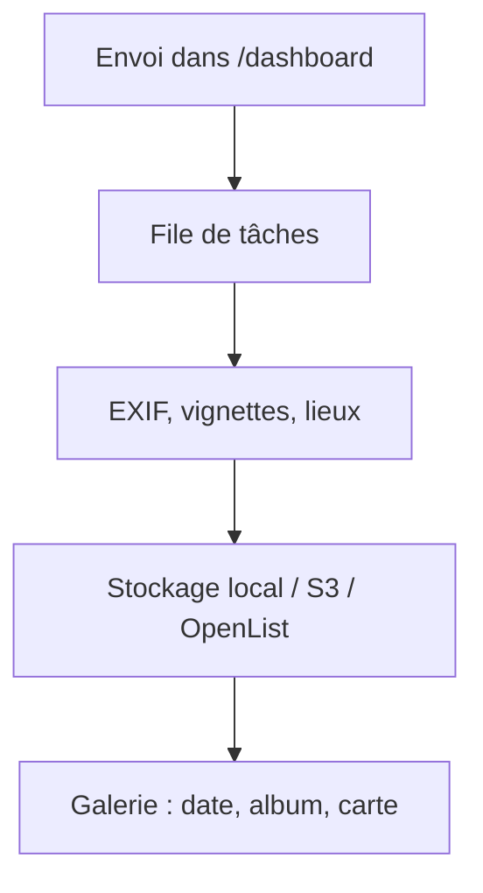

# HoshinoSuzumi/chronoframe

> Galerie photo auto-hébergée qui extrait EXIF, génère aperçus, localise les prises de vue et lit les Live Photos.

## Le problème
Héberger ses photos soi-même avec carte, albums et Live Photos sans passer par un service cloud.

## Ce que ça fait vraiment
Après envoi, une file de tâches traite EXIF, vignettes, géolocalisation inverse et appariement image/vidéo. Navigation par date, album ou carte (MapLibre/Mapbox), zoom WebGL, albums protégés par mot de passe, stockage local, S3 ou OpenList, assistant de configuration, connexion e-mail ou GitHub OAuth.

## Comment c'est branché
Schéma simplifié d'après la fiche, sans diagramme fourni.


## Essayer
```bash
docker compose up -d
docker run -d --name chronoframe --restart unless-stopped \
  -p 3000:3000 -v "$(pwd)/data:/app/data" \
  ghcr.io/hoshinosuzumi/chronoframe:latest
```

## Coût et pièges
Garder le volume ./data (base, secrets, photos). HTTPS pour une exposition publique. Un jeton de carte est optionnel. Les albums protégés ne protègent pas des URL publiques S3/CDN.

## Ce que ce n'est pas
Pas un outil de classement par IA. Version cloud payante possible, tarifs non précisés. AGPL.

## Alternatives
Aucune alternative nommée dans le README.

## Pour toi
Surveiller : une galerie perso propre pour un homelab, sans lien avec ton travail data/IA.

