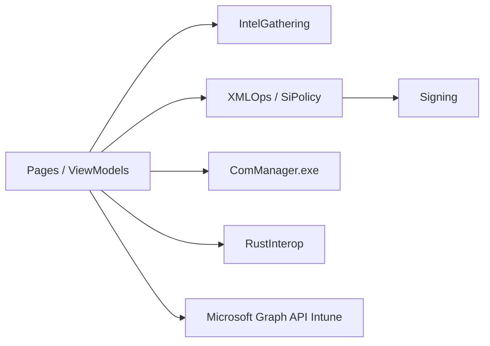

# HotCakeX/Harden-Windows-Security

> Two Windows applications (system hardening and AppControl) built on Microsoft's official mechanisms.

## The problem
Applying and verifying a consistent Windows hardening (policies, App Control) without third-party components.

## What it actually does
Repository of two .NET applications distributed through the Microsoft Store: Harden System Security (applies protections, checks compliance, Intune policies) and AppControl Manager (creation and deployment of WDAC policies). C++/Rust interop, DISM services and named-pipe relays, Microsoft Graph for Intune. The README is mostly a long guide of security recommendations.

## How it is wired

## Trying it
No command documented: installation from the Microsoft Store (no command line in the README).

## Cost and gotchas
Free, Windows only. The README puts forward protection figures ("~98%", "99%") with no verifiable method. A single maintainer; donations in cryptocurrencies.

## What it is not
Not a complete enterprise security solution: the README lists Defender, Sentinel, etc. as complements.

## Alternatives
No alternative named in the README.

## For you
Ignore: Windows-specific, single maintainer, no direct relation to data/AI/MLOps.
