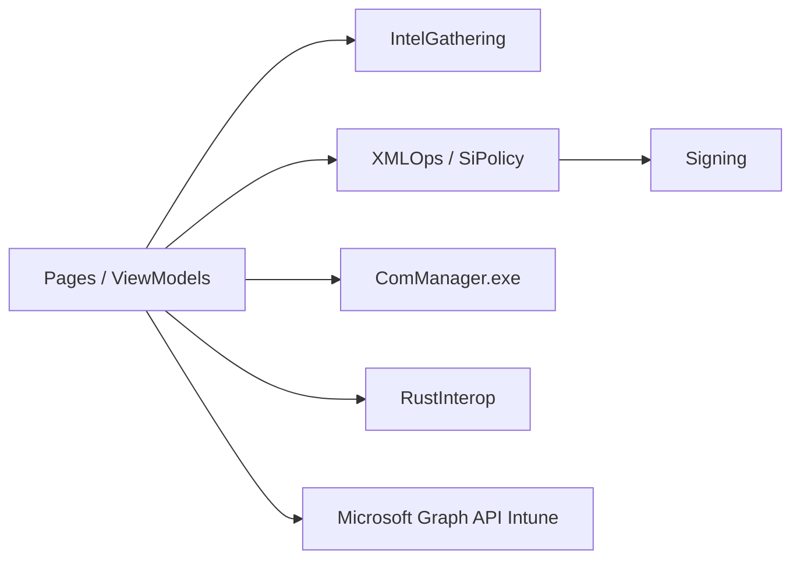

# HotCakeX/Harden-Windows-Security

> Deux applications Windows (durcissement système et AppControl) fondées sur les mécanismes officiels de Microsoft.

## Le problème
Appliquer et vérifier un durcissement Windows cohérent (policies, App Control) sans composants tiers.

## Ce que ça fait vraiment
Dépôt de deux applications .NET distribuées par le Microsoft Store : Harden System Security (applique les protections, vérifie la conformité, politiques Intune) et AppControl Manager (création et déploiement de politiques WDAC). Interop C++/Rust, services DISM et relais par pipes nommés, Microsoft Graph pour Intune. Le README est surtout un long guide de recommandations de sécurité.

## Comment c'est branché

## Essayer
Aucune commande documentée : installation depuis le Microsoft Store (pas de ligne de commande dans le README).

## Coût et pièges
Gratuit, Windows uniquement. Le README avance des chiffres de protection (« ~98 % », « 99 % ») sans méthode vérifiable. Un seul mainteneur ; dons en cryptomonnaies.

## Ce que ce n'est pas
Pas une solution de sécurité d'entreprise complète : le README liste Defender, Sentinel, etc. comme compléments.

## Alternatives
Aucune alternative nommée dans le README.

## Pour toi
À ignorer : spécifique à Windows, mainteneur unique, sans rapport direct avec data/IA/MLOps.

