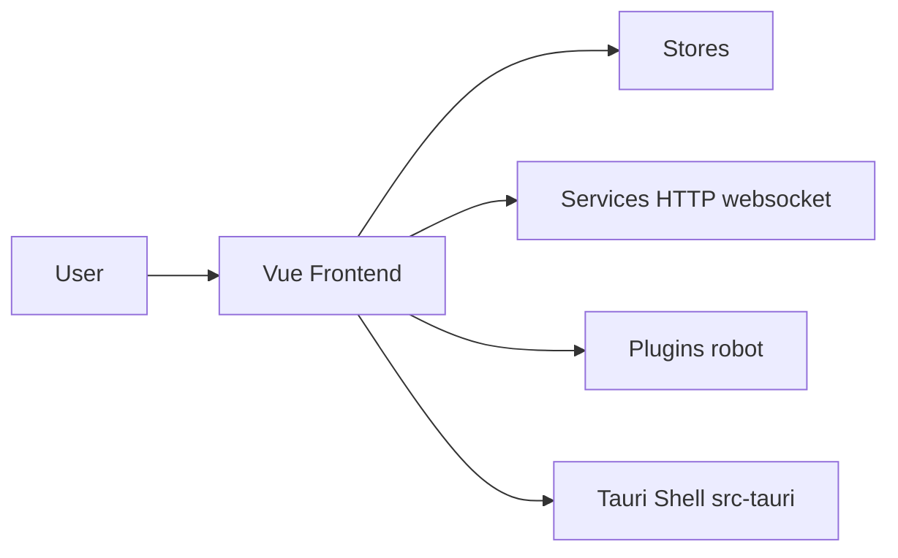

# HuLaSpark/HuLa

> Cross-platform instant messaging client built with Tauri, Vue 3 and TypeScript, with an AI assistant.

## The problem
A chat client that runs on desktop and mobile from a single web codebase.

## What it actually does
Vue 3 interface (`src/`: components, stores, router, HTTP and websocket services) in a Tauri/Rust shell (`src-tauri`). Private and group chat, audio/video calls, screenshots, file sending via Qiniu, themes, and a multi-provider AI "robot" plugin. The server is a separate repository (GitHub/Gitee).

## How it is wired


## Trying it
```bash
git clone https://github.com/HuLaSpark/HuLa.git
cd HuLa
pnpm install
pnpm run tauri:dev
```

## Cost and gotchas
Free, but you must deploy the server separately. File storage on Qiniu (third-party service). README in Chinese. Web not supported.

## What it is not
Not a standalone client: without a compatible server it does nothing. Not an AI agent framework.

## Alternatives
No alternative named in the README.

## For you
Ignore: generic messaging; the AI assistant is just one plugin among others.
