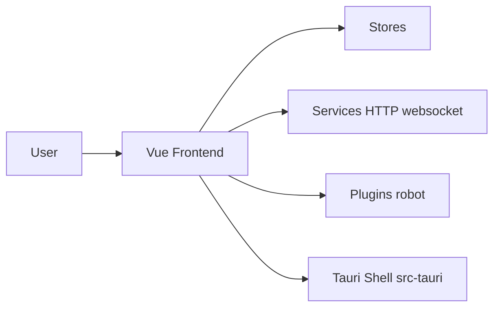

# HuLaSpark/HuLa

> Client de messagerie instantanée multiplateforme en Tauri, Vue 3 et TypeScript, avec assistant IA.

## Le problème
Un client de chat qui tourne sur bureau et mobile à partir d'une seule base de code web.

## Ce que ça fait vraiment
Interface Vue 3 (`src/` : components, stores, router, services HTTP et websocket) dans une coque Tauri/Rust (`src-tauri`). Chat privé et de groupe, appels audio/vidéo, captures d'écran, envoi de fichiers via Qiniu, thèmes, et un plugin « robot » d'IA multi-fournisseurs. Le serveur est un dépôt séparé (GitHub/Gitee).

## Comment c'est branché


## Essayer
```bash
git clone https://github.com/HuLaSpark/HuLa.git
cd HuLa
pnpm install
pnpm run tauri:dev
```

## Coût et pièges
Gratuit, mais il faut déployer le serveur à part. Stockage de fichiers sur Qiniu (service tiers). README en chinois. Web non supporté.

## Ce que ce n'est pas
Pas un client autonome : sans serveur compatible il ne fait rien. Pas un framework d'agents IA.

## Alternatives
Aucune alternative nommée dans le README.

## Pour toi
À ignorer : messagerie générique ; l'assistant IA n'est qu'un plugin parmi d'autres.

