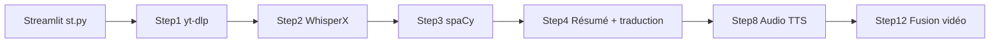

# Huanshere/VideoLingo

> Streamlit pipeline for subtitling, translating and dubbing videos, from YouTube or files.

## The problem
Producing well-segmented, consistently translated subtitles, then a dub, requires assembling several tools.

## What it actually does
Sequenced steps: download (yt-dlp), word-level transcription (WhisperX), NLP segmentation (spaCy), summary and terminology, translation with reflection then rewriting via an OpenAI-compatible LLM, subtitle generation, then dubbing (GPT-SoVITS, Azure, OpenAI, Fish TTS, Edge, F5-TTS). Logging with resume. Limits listed by the README: noise, mixed languages, no distinct voice per speaker.

## How it is wired


## Trying it
```bash
git clone https://github.com/Huanshere/VideoLingo.git
cd VideoLingo
uv run --no-project --python 3.13 setup_env.py
.venv/bin/streamlit run st.py
docker build -t videolingo .
```

## Cost and gotchas
FFmpeg 7 as shared libraries required. NVIDIA GPU recommended. You need a URL, a key and an OpenAI-compatible LLM model able to return structured JSON: the bill is on you.

## What it is not
It is not a hosted service: everything runs on your machine. It is not a guarantee of perfect translation.

## Alternatives
The README does not cite any other project.

## For you
Worth watching: a good example of an ASR + LLM + TTS pipeline with resume, to read for its segmentation choices rather than to deploy as is.
