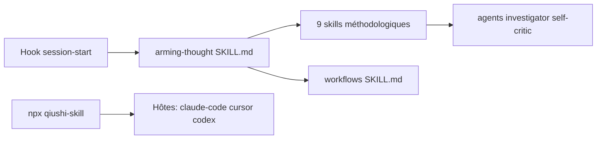

# HughYau/qiushi-skill

> Collection of agent skills that impose a reasoning method drawn from Maoist texts, for Claude Code and similar tools.

## The problem
An agent jumps to conclusions without investigating, does not re-read its work and gives up in the face of difficulty; the author wants to impose a discipline of thought on it.

## What it actually does
A core of about fifty lines is injected at the start of every session (`session-start` hook), with four rules: conclude according to evidence, separate facts, inferences and unknowns, declare finished only what is verified, diagnose before giving up. Nine skills load on demand (analysis of contradictions, prior investigation, self-criticism, concentration of forces…), with `/…` commands, two sub-agents (`investigator`, `self-critic`) and chains (`workflows`). The quotations come from the selected works of Mao; the README is in Chinese.

## How it is wired


## Trying it
```bash
npx qiushi-skill
npx qiushi-skill install --target claude-code --scope user
npx qiushi-skill validate
```

## Cost and gotchas
Free; installation writes into each host's skills folders. The injected core consumes context in every session. No quantified evaluation of the effect is provided.

## What it is not
Not a technical tool: it is instructions in text. The author states that it is neither propaganda nor a "personality distillation"; the effect on code quality is not demonstrated.

## Alternatives
`obra/superpowers`, cited as a source of inspiration: a skills framework oriented toward software development.

## For you
Ignore: no measured gain, context consumed every session, and an ideological framework unrelated to your work; `superpowers` is closer to your use.
