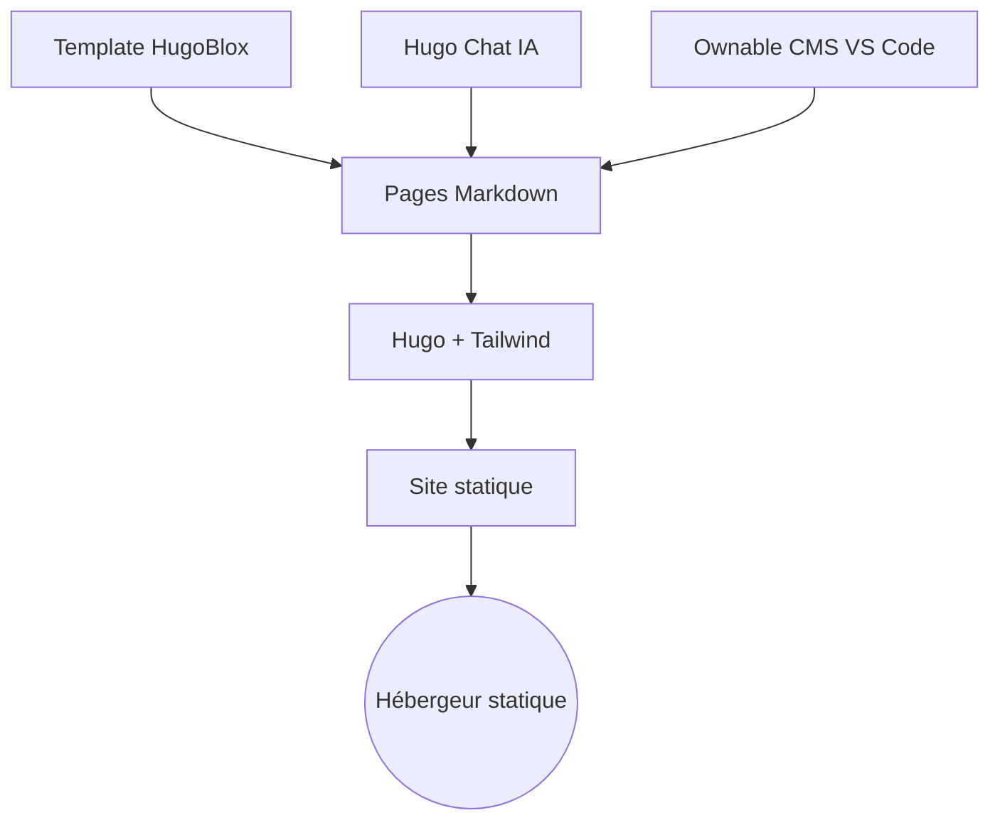

# HugoBlox/kit

> Hugo framework for building Markdown-based sites, with AI page generation.

## The problem
AI site generators produce code that is hard to maintain; CMSs lock content inside a database.

## What it actually does
Hugo + Tailwind templates with more than 20 content types (landing, blog, BibTeX publications, docs, teams, CV, reveal.js slides, Jupyter notebooks). Hugo Chat generates pages in Markdown; the visual editor Ownable CMS runs inside VS Code. Static output, deployable on Netlify, Vercel or GitHub Pages.

## How it is wired


## Trying it
```bash
npm install -g hugoblox
hugoblox create site
```

## Cost and gotchas
Hugo Extended and Node required. Hugo Chat offers free daily messages; visual editing, automations and BibTeX import are reserved for the Pro plan.

## What it is not
Not entirely free: the AI layer and visual editing push toward the paid tier. The figures and testimonials in the README are self-reported.

## Alternatives
- Lovable, v0, Bolt (cited): to generate React code rather than Markdown.
- WordPress, Webflow (cited): if you want a database-backed CMS.

## For you
Worth watching: useful for a research site or a static portfolio, but the last push dates from August 2026 and the AI features go through a third-party service.
