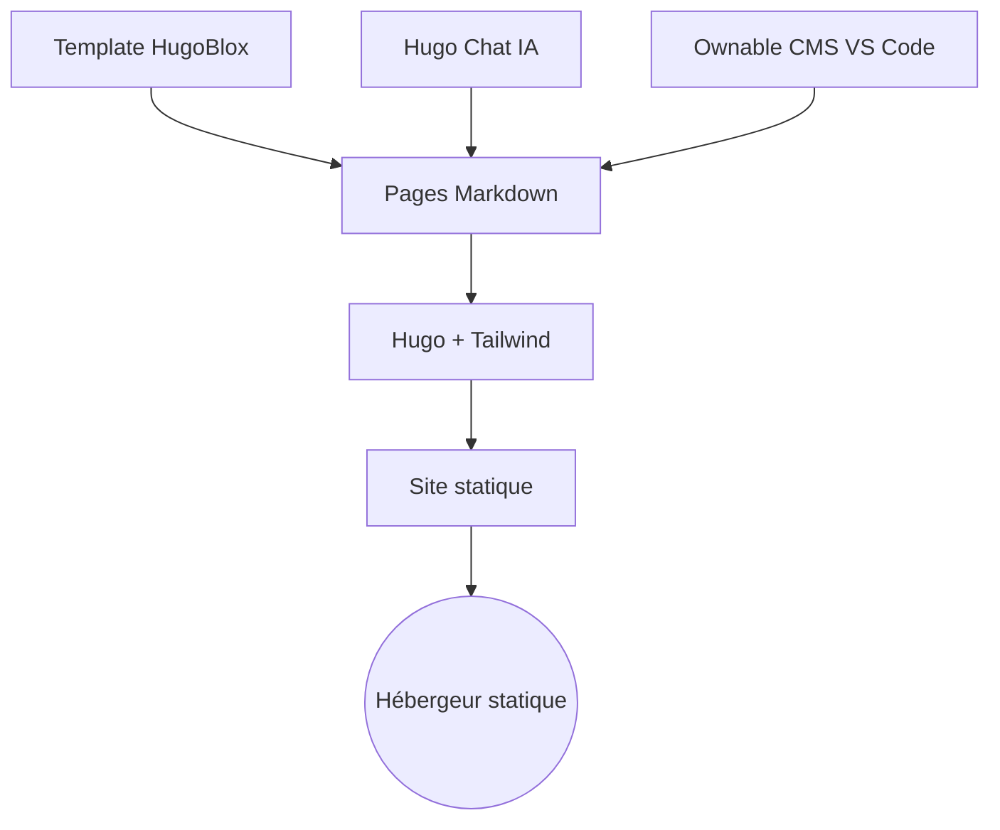

# HugoBlox/kit

> Framework Hugo pour construire des sites en Markdown, avec génération de pages par IA.

## Le problème
Les générateurs de sites IA produisent du code difficile à maintenir ; les CMS enferment le contenu dans une base.

## Ce que ça fait vraiment
Des modèles Hugo + Tailwind avec plus de 20 types de contenu (landing, blog, publications BibTeX, docs, équipes, CV, slides reveal.js, notebooks Jupyter). Hugo Chat génère les pages en Markdown ; l'éditeur visuel Ownable CMS fonctionne dans VS Code. Sortie statique, déployable sur Netlify, Vercel ou GitHub Pages.

## Comment c'est branché


## Essayer
```bash
npm install -g hugoblox
hugoblox create site
```

## Coût et pièges
Hugo Extended et Node requis. Hugo Chat offre des messages gratuits quotidiens ; édition visuelle, automatisations et import BibTeX sont réservés à l'offre Pro.

## Ce que ce n'est pas
Pas entièrement gratuit : la couche IA et l'édition visuelle poussent vers le payant. Les chiffres et témoignages du README sont autodéclarés.

## Alternatives
- Lovable, v0, Bolt (cités) : pour générer du code React plutôt que du Markdown.
- WordPress, Webflow (cités) : si tu veux un CMS à base de données.

## Pour toi
À surveiller : utile pour un site de recherche ou un portfolio statique, mais le dernier push date d'août 2026 et les fonctions IA passent par un service tiers.

