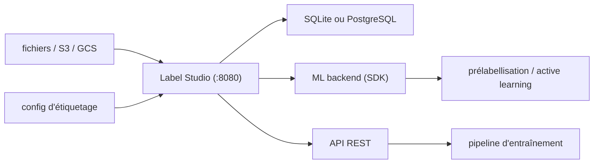

# HumanSignal/label-studio

> Multi-type annotation tool (image, text, audio, video, time series), self-hostable.

## The problem
Annotating without a dedicated tool means spreadsheets, scattered files and no trace of who annotated what.
Re-annotating after a change in the label schema amounts to starting over.

## What it actually does
Annotation interface configurable through a dedicated configuration language, with ready-made templates for common cases.
Multi-user and multi-project: each annotation is tied to an account.
Import from files or cloud storage (S3, GCS, JSON, CSV, TSV, RAR, ZIP); export to several model formats.
Connection of an ML backend: pre-labeling from predictions, online learning, active learning on hard examples.

## How it is wired


## Trying it
```bash
pip install label-studio
label-studio
docker pull heartexlabs/label-studio:latest
docker run -it -p 8080:8080 -v $(pwd)/mydata:/label-studio/data heartexlabs/label-studio:latest
docker-compose up
docker compose -f docker-compose.yml -f docker-compose.minio.yml up -d
```

## Cost and gotchas
The self-hosted edition is freely accessible; the publisher pushes a Starter Cloud with a free trial and differentiated editions.
SQLite by default: the production compose requires Nginx and PostgreSQL; Windows requires precompiled wheels.

## What it is not
Not an automatic annotator: the ML backend pre-labels, the human validates.
Not a single offering: features vary by edition, the README points to a comparison page.
Not monolithic: frontend, data manager, converter and transformers are separate repositories.

## Alternatives
label-studio-converter: encode labels in your library's format, without going through the UI.
label-studio-transformers: the Transformers library already wired for Label Studio.

## For you
The reference for building a clean annotated dataset; deploy with the PostgreSQL compose as soon as several people annotate.
