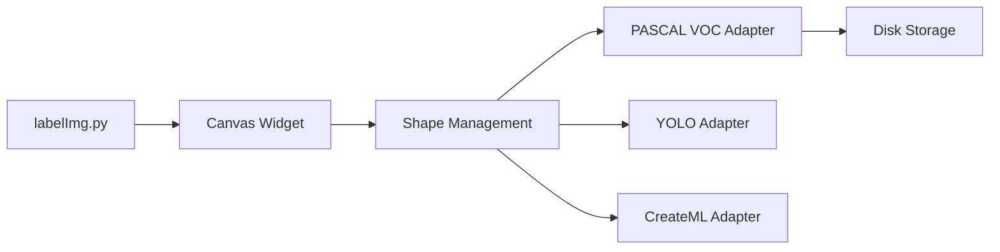

# HumanSignal/labelImg

> Qt graphical tool for annotating bounding boxes, now archived in favor of Label Studio.

## The problem
Building object-detection datasets requires drawing boxes on images and exporting them in the right format.

## What it actually does
Python/PyQt desktop application: you open a folder of images, draw rectangles and name the classes. Exports PASCAL VOC (XML), YOLO (txt) or CreateML. A list of predefined classes loads from `data/predefined_classes.txt`. The README's author states that the project is no longer developed and points to Label Studio.

## How it is wired


## Trying it
```bash
pip3 install labelImg
labelImg
labelImg [IMAGE_PATH] [PRE-DEFINED CLASS FILE]
```

## Cost and gotchas
Free. The Qt/lxml installation can be painful (the README offers virtualenv, conda and Docker). In YOLO, the "difficult" flag is lost and the class list must not change during a session.

## What it is not
No longer maintained (451 open issues, last push in 2024-06). It only handles images and boxes, not text, audio or video.

## Alternatives
- Label Studio: the successor cited in the README, multi-modal (images, text, hypertext, audio, video, time series).

## For you
Ignore for a new project: archived and replaced by Label Studio; keep only for an occasional need for local YOLO boxes.
