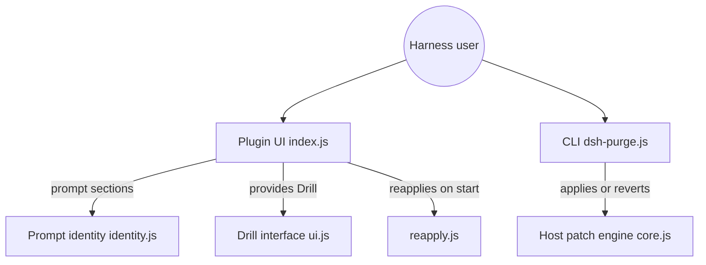

# HunYiSage/dsh-purge

> Plugin qui patche DeepSeek Harness local pour retirer ses garde-fous, vendu comme outil de red team.

## Le problème
Les politiques par défaut du harnais DeepSeek (prompts, approbations, sandbox) bloquent certaines requêtes ; l'outil prétend séparer refus du modèle et blocage de l'hôte.

## Ce que ça fait vraiment
- S'installe comme plugin de `dsh` (profil web ou desktop), ajoute un bouton « dock » avec deux pages : Clean et Drill.
- Clean : applique ou annule des patchs sur les paquets `@deepseek-ai` locaux, édite le prompt injecté et des jeux de règles.
- Drill : espace de red team (skills, base de connaissances) derrière un avis d'autorisation.
- Réapplique les patchs au démarrage ; commandes `dsh-purge --apply|--revert|--uninstall`.

## Comment c'est branché


## Essayer
```bash
dsh plugin --profile web add https://codeload.github.com/HunYiSage/dsh-purge/tar.gz/refs/heads/master
dsh-purge --status
dsh-purge --apply
```

## Coût et pièges
Gratuit, mais cible un DSH précis (0.2.1-rc.2) ; les RC suivantes ne sont pas supportées. Le README alerte sur usurpations, builds modifiés et arnaques. Le plugin peut contacter son dépôt GitHub pour les mises à jour.

## Ce que ce n'est pas
Pas un scanner public ni un kit d'attaque, selon le README. Le prompt d'identité est chiffré dans le plugin : non auditable à la lecture. Redistribution commerciale interdite malgré Apache-2.0 (clause d'attribution).

## Alternatives
Le README ne nomme aucune alternative.

## Pour toi
À ignorer : il modifie des paquets locaux pour contourner des restrictions, sans intérêt data/MLOps, avec un prompt chiffré et un contexte d'usurpations qui justifient la méfiance.

