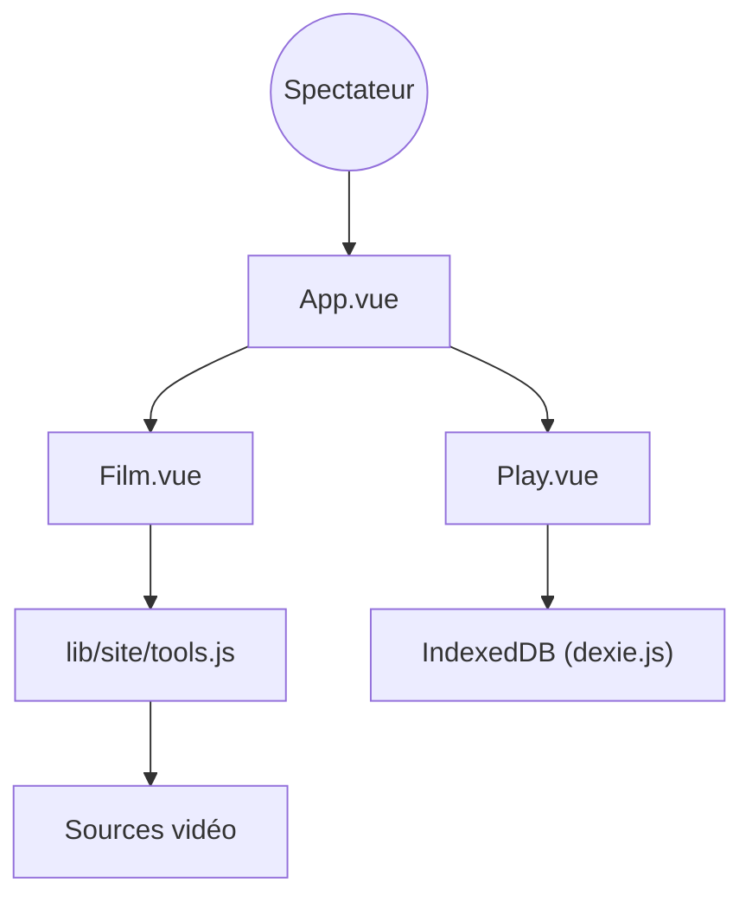

# Hunlongyu/ZY-Player

> Desktop video resource and IPTV player, for viewers who read Chinese.

## The problem
Browsing several video and live channel sources forces you to juggle separate sites and players.

## What it actually does
Electron application with a Vue interface: browsing in poster or list mode, search across all sources, details, playback with history and progress resume, favorites, IPTV channels, customizable sources, sharing and export, third-party player. Local data is stored in IndexedDB.

## How it is wired

## Trying it
No documented command. The README states that downloading is temporarily closed.

## Cost and gotchas
Free, but downloading is closed according to the README. The last push dates from February 2023. The README claims the resources come from the web and asks you to delete the software within 24 hours: legal risk on the content side.

## What it is not
Not a content provider: it hosts nothing. Not a maintained application: activity is old.

## Alternatives
- No alternative named in the README.

## For you
Ignore: no activity since 2023, unrelated to data or AI, and a gray area on content.
