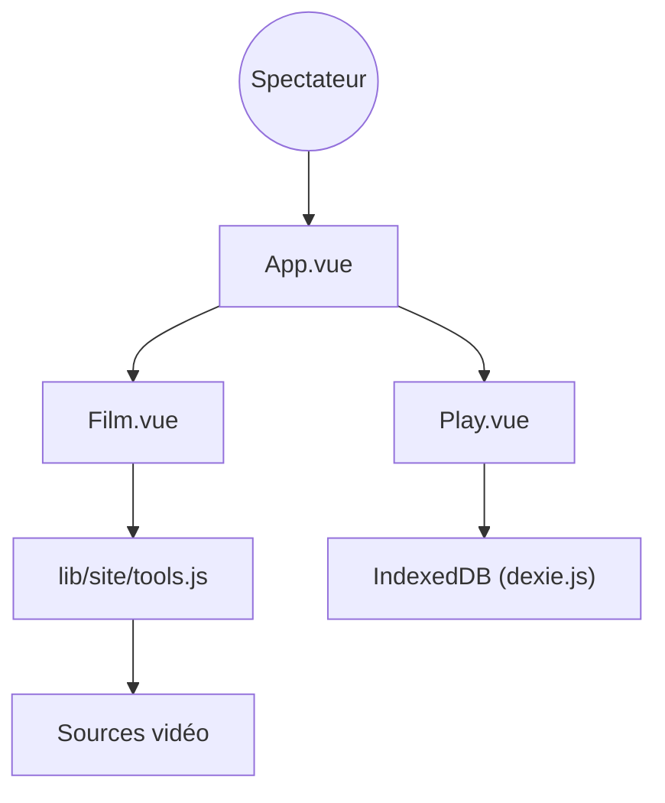

# Hunlongyu/ZY-Player

> Lecteur de ressources vidéo et IPTV de bureau, pour spectateurs lisant le chinois.

## Le problème
Parcourir plusieurs sources de vidéos et de chaînes en direct oblige à jongler entre des sites et des lecteurs séparés.

## Ce que ça fait vraiment
Application Electron avec interface Vue : navigation en mode affiches ou liste, recherche dans toutes les sources, détails, lecture avec historique et reprise de progression, favoris, chaînes IPTV, sources personnalisables, partage et export, lecteur tiers. Les données locales sont dans IndexedDB.

## Comment c'est branché

## Essayer
Aucune commande documentée. Le README indique que le téléchargement est temporairement fermé.

## Coût et pièges
Gratuit, mais le téléchargement est fermé d'après le README. Le dernier push date de février 2023. Le README affirme que les ressources viennent du web et demande de supprimer le logiciel sous 24 heures : risque juridique côté contenus.

## Ce que ce n'est pas
Pas un fournisseur de contenus : il n'héberge rien. Pas une application maintenue : l'activité est ancienne.

## Alternatives
- Aucune alternative nommée dans le README.

## Pour toi
À ignorer : sans activité depuis 2023, sans lien avec la data ou l'IA, et avec une zone grise sur les contenus.

