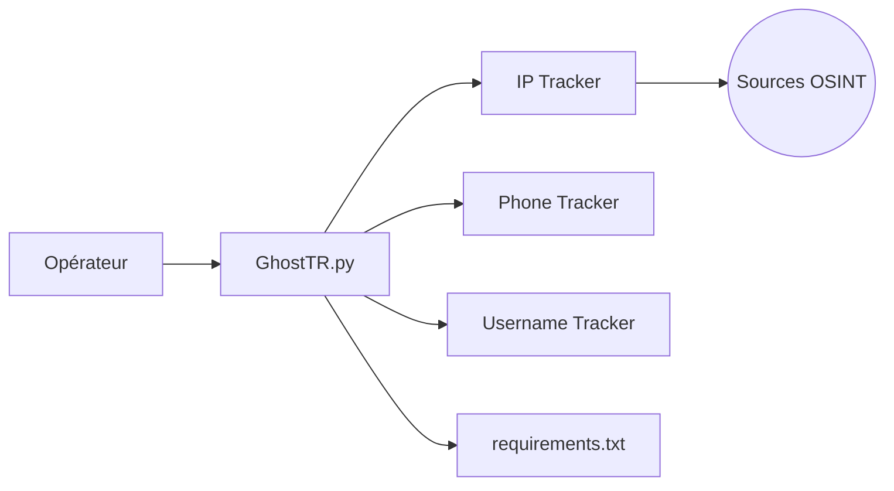

# HunxByts/GhostTrack

> Interactive Python script for looking up information on an IP address, a phone number or a username.

## The problem
Open-source intelligence (OSINT) lookups on an IP, a number or a username are done by hand, source by source. The tool gathers these three lookups in a single menu.

## What it actually does
- A single script, `GhostTR.py`, with a menu: IP Tracker, Phone Tracker, Username Tracker.
- It queries public sources from the user's machine and displays the result in the terminal.
- The README cites the third-party tool Seeker as a way to obtain an IP upstream. The sources queried are not named.
- Manual and interactive use only, with no database or server.

## How it is wired


## Trying it
```bash
git clone https://github.com/HunxByts/GhostTrack.git
cd GhostTrack
pip3 install -r requirements.txt
python3 GhostTR.py
```

## Cost and gotchas
Free, Python 3 and the dependencies in `requirements.txt`. No license declared: reuse is legally uncertain. Looking up information about an identifiable person falls under data protection rules (GDPR in particular): a legal basis is required.

## What it is not
Neither a guaranteed reliable geolocation tool nor a maintained product: last commit in January 2024, with no documentation of the sources or the limits.

## Alternatives
- seeker (thewhiteh4t/seeker): cited in the README as an upstream tool for obtaining an IP.

## For you
With no license, no maintenance and a usage centered on people, it brings nothing to a data/AI/MLOps flow: ignore.
