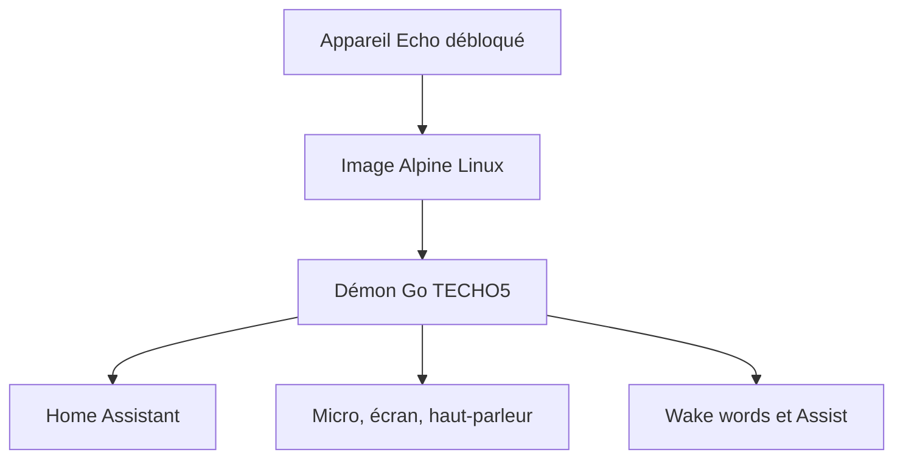

# HuskerMinion/techo5

> Open firmware that replaces Alexa on Echo Show devices with Linux and Home Assistant, with no Amazon cloud.

## The problem
Echo Show devices depend on Amazon and Alexa, with little local control over voice and data.

## What it actually does
- Replaces Fire OS with an Alpine Linux image and a Go daemon.
- Turns the device into a Home Assistant voice satellite with a touchscreen.
- Handles alarms, timers, AirPlay 2, DLNA, Snapcast, dashboards and camera.
- Covers several Echo models (Show 5 and 8, Spot, Dot), an Android app for tablets and a Skylight wall calendar.

## How it is wired
Simplified diagram based on the sheet, no diagram provided.


## Trying it
```bash
# Commandes non reprises dans le README fourni : voir docs/install-athena.md
# et docs/install-skylight.md pour les installations.
```

## Cost and gotchas
Requires an Echo device to unlock (amonet exploit) and Home Assistant. Flashing may wipe everything: make a full backup first. No Echo released after 2021 has a public unlock.

## What it is not
Not software for every Echo: only the listed models work. The README was truncated: the rest was not read.

## Alternatives
- EchoLocal, EchoMuse, echo-dot-assist, Kiosk Satellite and View Assist: compared in `docs/comparison.md`.

## For you
Ignore: home automation and hardware tinkering, outside your data, AI or MLOps field.
