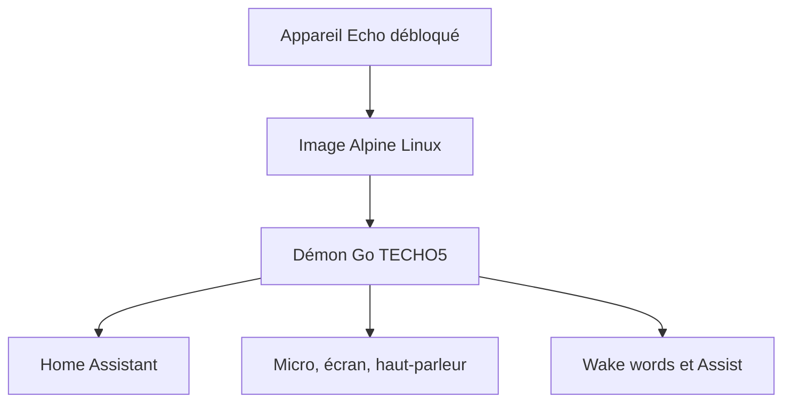

# HuskerMinion/techo5

> Firmware libre qui remplace Alexa sur les Echo Show par Linux et Home Assistant, sans cloud Amazon.

## Le problème
Les Echo Show dépendent d'Amazon et d'Alexa, avec peu de contrôle local sur la voix et les données.

## Ce que ça fait vraiment
- Remplace Fire OS par une image Alpine Linux et un démon Go.
- Fait de l'appareil un satellite vocal Home Assistant avec écran tactile.
- Gère alarmes, minuteurs, AirPlay 2, DLNA, Snapcast, tableaux de bord et caméra.
- Couvre plusieurs Echo (Show 5 et 8, Spot, Dot), une application Android pour tablettes et un calendrier mural Skylight.

## Comment c'est branché
Schéma simplifié d'après la fiche, sans diagramme fourni.


## Essayer
```bash
# Commandes non reprises dans le README fourni : voir docs/install-athena.md
# et docs/install-skylight.md pour les installations.
```

## Coût et pièges
Matériel Echo à déverrouiller (exploit amonet) et Home Assistant requis. Le flashage peut tout effacer : sauvegarde complète avant. Aucun Echo postérieur à 2021 n'a de déverrouillage public.

## Ce que ce n'est pas
Pas un logiciel pour tout Echo : seuls les modèles listés fonctionnent. README tronqué : la suite n'a pas été lue.

## Alternatives
- EchoLocal, EchoMuse, echo-dot-assist, Kiosk Satellite et View Assist : comparés dans `docs/comparison.md`.

## Pour toi
À ignorer : domotique et bidouille matérielle, hors de ton champ data, IA ou MLOps.

