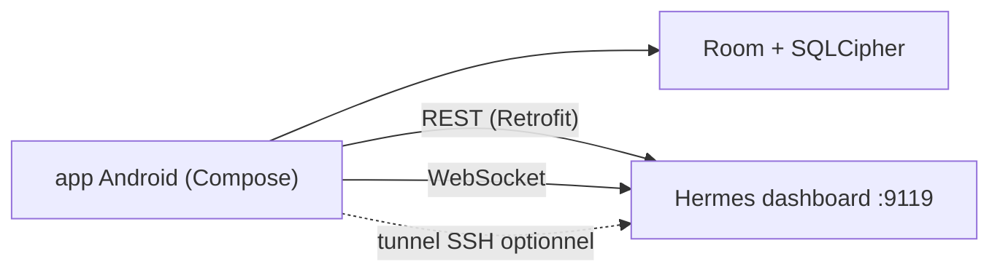

# Hy4ri/hermes-mobile

> Native Android app to control a Hermes agent from your phone: chat, cron tasks, skills, logs.

## The problem
Managing your Hermes agent (cron, profiles, models, logs) forces you to use the web dashboard on a computer.

## What it actually does
Connects to the Hermes dashboard (REST and WebSocket). Chat with encrypted local history (Room, SQLCipher), management of profiles, skills, plugins, cron tasks, environment keys and live logs. Security options: app lock, profile lock, mTLS, per-origin CA, SSH tunnel, Cloudflare Access headers.

## How it is wired
Simplified diagram based on the sheet, no diagram provided.



## Trying it
```bash
hermes dashboard
git clone https://github.com/Hy4ri/hermes-mobile.git
cd hermes-mobile
./gradlew assembleDebug
adb install app/build/outputs/apk/debug/app-debug.apk
```

## Cost and gotchas
You need a Hermes dashboard reachable from the phone; over plain HTTP, only on a trusted network. Building requires JDK 21+ and the Android SDK. The SSH tunnel opens a local port readable by the phone's other applications.

## What it is not
Not an agent nor a model provider: a client. The app and profile locks are local, not server-side permissions.

## Alternatives
No alternative named in the README.

## For you
Watch: only useful if you run Hermes Agent; serious about security and very active, but a single maintainer.
