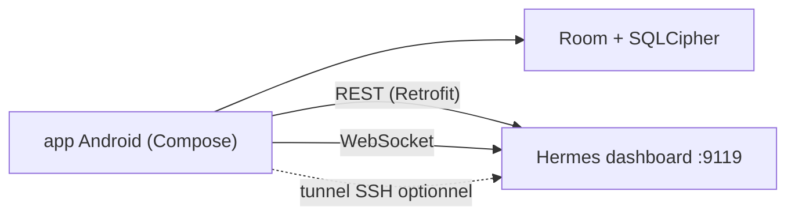

# Hy4ri/hermes-mobile

> Application Android native pour piloter un agent Hermes depuis le téléphone : chat, tâches cron, skills, journaux.

## Le problème
Gérer son agent Hermes (cron, profils, modèles, logs) oblige à passer par le tableau de bord web sur un ordinateur.

## Ce que ça fait vraiment
Se connecte au tableau de bord Hermes (REST et WebSocket). Chat avec historique local chiffré (Room, SQLCipher), gestion des profils, skills, plugins, tâches cron, clés d'environnement et journaux en direct. Options de sécurité : verrouillage de l'application, verrou de profil, mTLS, CA par origine, tunnel SSH, en-têtes Cloudflare Access.

## Comment c'est branché
Schéma simplifié d'après la fiche, sans diagramme fourni.



## Essayer
```bash
hermes dashboard
git clone https://github.com/Hy4ri/hermes-mobile.git
cd hermes-mobile
./gradlew assembleDebug
adb install app/build/outputs/apk/debug/app-debug.apk
```

## Coût et pièges
Il faut un tableau de bord Hermes joignable depuis le téléphone ; en HTTP clair, seulement sur réseau de confiance. Compilation : JDK 21+ et SDK Android. Le tunnel SSH ouvre un port local lisible par les autres applications du téléphone.

## Ce que ce n'est pas
Pas un agent ni un fournisseur de modèles : un client. Les verrous d'application et de profil sont locaux, pas des permissions côté serveur.

## Alternatives
Aucune alternative nommée dans le README.

## Pour toi
Surveiller : utile seulement si tu fais tourner Hermes Agent ; sérieux sur la sécurité et très actif, mais un seul mainteneur.

