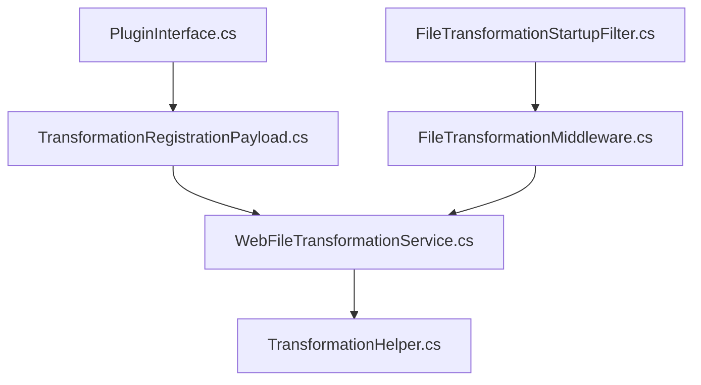

# IAmParadox27/jellyfin-plugin-file-transformation

> Jellyfin plugin that modifies served web files on the fly, for other plugins.

## The problem
Customizing the Jellyfin interface means editing files by hand, which every update erases.

## What it actually does
Other plugins register a transformation (a file pattern and a callback method) through PluginInterface. A middleware intercepts the served files and passes them through that callback. Nothing is written to disk.

## How it is wired


## Trying it
```bash
# Aucune commande : ajouter https://www.iamparadox.dev/jellyfin/plugins/manifest.json
# comme dépôt de plugins dans Jellyfin, installer "File Transformation", redémarrer.
```

## Cost and gotchas
Free, no configuration. Compatible with only one Jellyfin version at a time: wait for the update after an upgrade. A single maintainer, GPL-3.0.

## What it is not
Not a tool you can use on its own: it serves as a base for other plugins. Not related to data.

## Alternatives
None named in the README.

## For you
Ignore: useful only if you administer a Jellyfin server.
