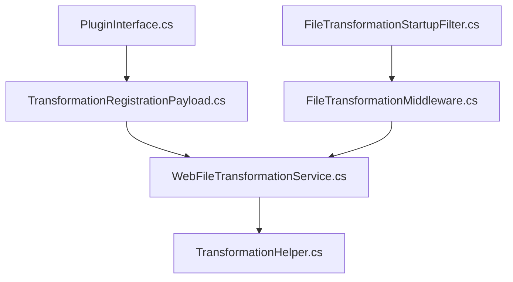

# IAmParadox27/jellyfin-plugin-file-transformation

> Plugin Jellyfin qui modifie à la volée les fichiers web servis, pour d'autres plugins.

## Le problème
Personnaliser l'interface de Jellyfin oblige à modifier les fichiers à la main, ce que chaque mise à jour efface.

## Ce que ça fait vraiment
D'autres plugins enregistrent via PluginInterface une transformation (motif de fichier et méthode de rappel). Un middleware intercepte les fichiers servis et les passe par ce rappel. Rien n'est écrit sur disque.

## Comment c'est branché


## Essayer
```bash
# Aucune commande : ajouter https://www.iamparadox.dev/jellyfin/plugins/manifest.json
# comme dépôt de plugins dans Jellyfin, installer "File Transformation", redémarrer.
```

## Coût et pièges
Gratuit, sans configuration. Compatible une seule version de Jellyfin à la fois : attendre la mise à jour après un upgrade. Un seul mainteneur, GPL-3.0.

## Ce que ce n'est pas
Pas un outil utilisable seul : il sert de base à d'autres plugins. Pas lié à la data.

## Alternatives
Aucune nommée dans le README.

## Pour toi
À ignorer : utile seulement si tu administres un serveur Jellyfin.

