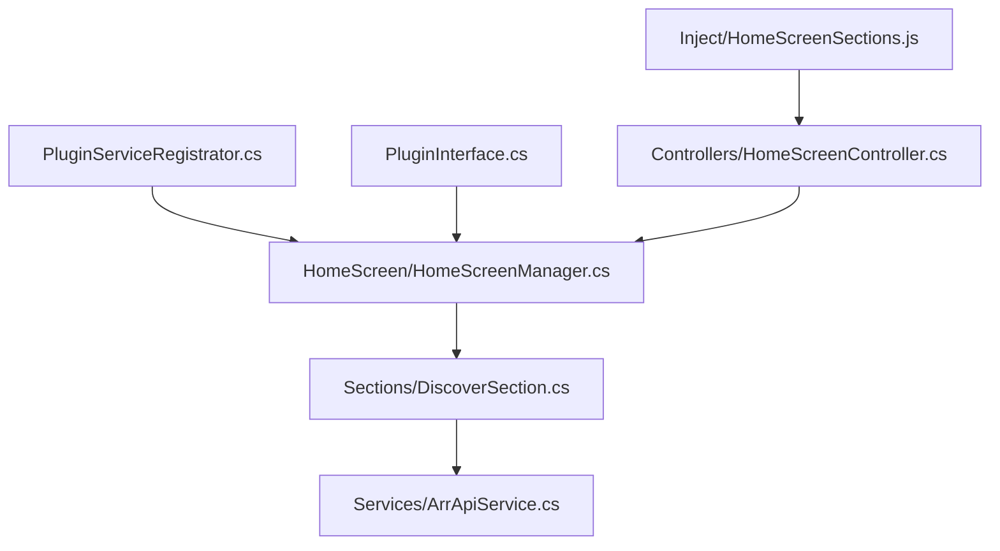

# IAmParadox27/jellyfin-plugin-home-sections

> Jellyfin plugin that replaces the home screen with dynamic Netflix-style rows.

## The problem
Jellyfin's standard home screen is static, with no rows personalized from watch history.

## What it actually does
Adds rows (Because you watched, Genre, Studio, Decade, Hidden gems, Collections to finish) and Jellyseerr and *arr rows (discover, my requests, upcoming). Replaces the entire home screen. Other plugins: a section can be registered by reflection.

## How it is wired


## Trying it
```bash
# Aucune commande : ajouter https://www.iamparadox.dev/jellyfin/plugins/manifest.json
# aux dépôts de plugins, installer "Home Screen Sections", redémarrer Jellyfin.
```

## Cost and gotchas
Jellyfin 10.10.7 or later, plus the File Transformation and Plugin Pages plugins. Compatible with one version at a time. Cards forced to landscape.

## What it is not
Does not coexist with the standard home screen: it replaces it. Not related to data.

## Alternatives
None named in the README.

## For you
Ignore: only useful for a Jellyfin media server.
