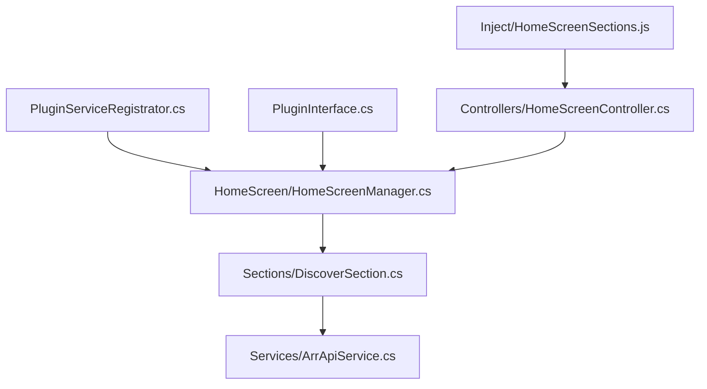

# IAmParadox27/jellyfin-plugin-home-sections

> Plugin Jellyfin qui remplace l'écran d'accueil par des rangées dynamiques façon Netflix.

## Le problème
L'accueil standard de Jellyfin est statique, sans rangées personnalisées selon l'historique.

## Ce que ça fait vraiment
Ajoute des rangées (Parce que vous avez regardé, Genre, Studio, Décennie, Pépites cachées, Collections à finir) et des rangées Jellyseerr et *arr (découvrir, mes demandes, à venir). Remplace l'accueil entier. Autres plugins : section enregistrable par réflexion.

## Comment c'est branché


## Essayer
```bash
# Aucune commande : ajouter https://www.iamparadox.dev/jellyfin/plugins/manifest.json
# aux dépôts de plugins, installer "Home Screen Sections", redémarrer Jellyfin.
```

## Coût et pièges
Jellyfin 10.10.7 ou plus, plus les plugins File Transformation et Plugin Pages. Compatible une seule version à la fois. Cartes forcées en paysage.

## Ce que ce n'est pas
Ne cohabite pas avec l'accueil standard : il le remplace. Pas lié à la data.

## Alternatives
Aucune nommée dans le README.

## Pour toi
À ignorer : utile seulement pour un serveur multimédia Jellyfin.

