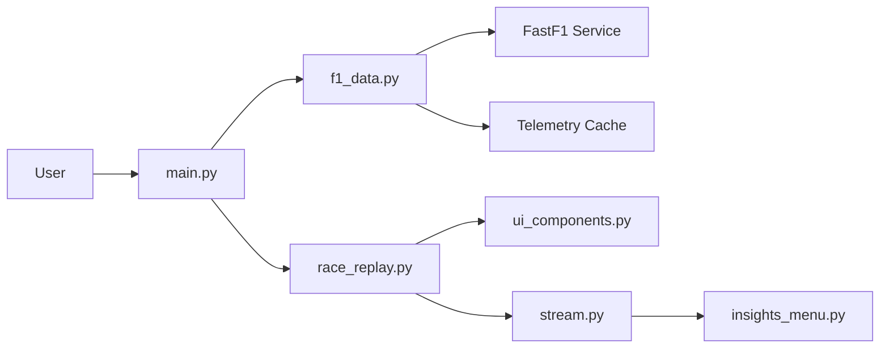

# IAmTomShaw/f1-race-replay

> Python application that replays a Formula 1 race from FastF1 telemetry.

## The problem
Public F1 telemetry data is raw; without a tool, it is impossible to visualize positions, tyres and safety cars lap by lap.

## What it actually does
Loads a session (race, sprint, qualifying) via FastF1, caches it, then renders it with Arcade: track, standings, tyres, DRS.
Playback controls (pause, rewind, speed 0.5x to 4x), driver selection to see speed and gear engaged.
Safety car simulated at ~500 m ahead of the leader, for lack of real GPS.
A telemetry stream feeds customizable "Insights" windows (`PitWallWindow` class).

## How it is wired


## Trying it
```bash
git clone https://github.com/IAmTomShaw/f1-race-replay
cd f1-race-replay
pip install -r requirements.txt
python main.py
python main.py --viewer --year 2025 --round 12
```

## Cost and gotchas
Free; first load of a session is long (download + computation). OpenGL 3.3+ required; known issue under conda.

## What it is not
Not an exact analysis tool: the standings are wrong in the first corners and during pit stops. No license declared, declared non-commercial use.

## Alternatives
No alternative named in the README.

## For you
Ignore on the professional side: a fun project without a license, useful at most as an example of FastF1 usage for a sports-data side project.
