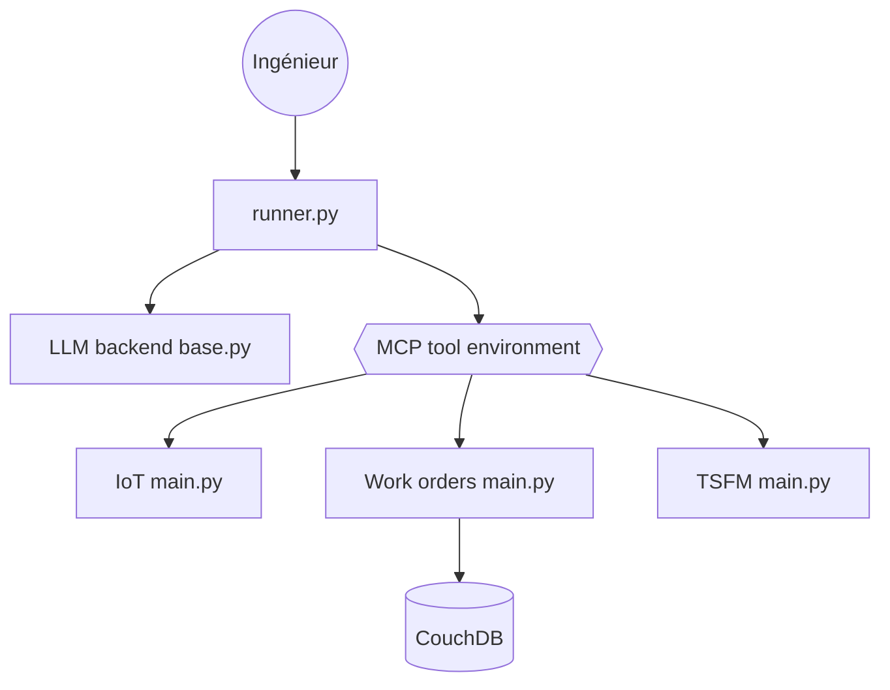

# IBM/AssetOpsBench

> Framework for evaluating and orchestrating AI agents for industrial equipment maintenance.

## The problem
There is no reproducible benchmark for judging agents on maintenance tasks: sensors, work orders, failure modes.

## What it actually does
Provides 141 scenarios, six MCP servers (IoT, FMSR, TSFM, work orders, vibration, utilities) and several orchestrators: Plan Execute, Deep Agent, Claude Agent, OpenAI Agent. An evaluation module scores trajectories with an LLM judge. Data goes through CouchDB.

## How it is wired


## Trying it
```bash
git clone https://github.com/IBM/AssetOpsBench.git
cd AssetOpsBench
pip install -e .
python -m assetopsbench.run --scenario "List all sensors of Chiller 6 in MAIN site"
```
The second command is marked "to be enabled" in the README.

## Cost and gotchas
A model API key is at your expense. CouchDB is needed for the data servers. The model leaderboard is marked "to be reviewed" in the README. An `AOB_READONLY=1` mode limits the work-order tools to read-only.

## What it is not
Not a factory-ready maintenance product: it is a benchmark in a simulated environment. The main branch evolves, and the paper versions live on other branches.

## Alternatives
None cited in the README.

## For you
Worth watching: a useful reference for evaluating MCP agents on time-series data, but mostly relevant if you work in industry.
