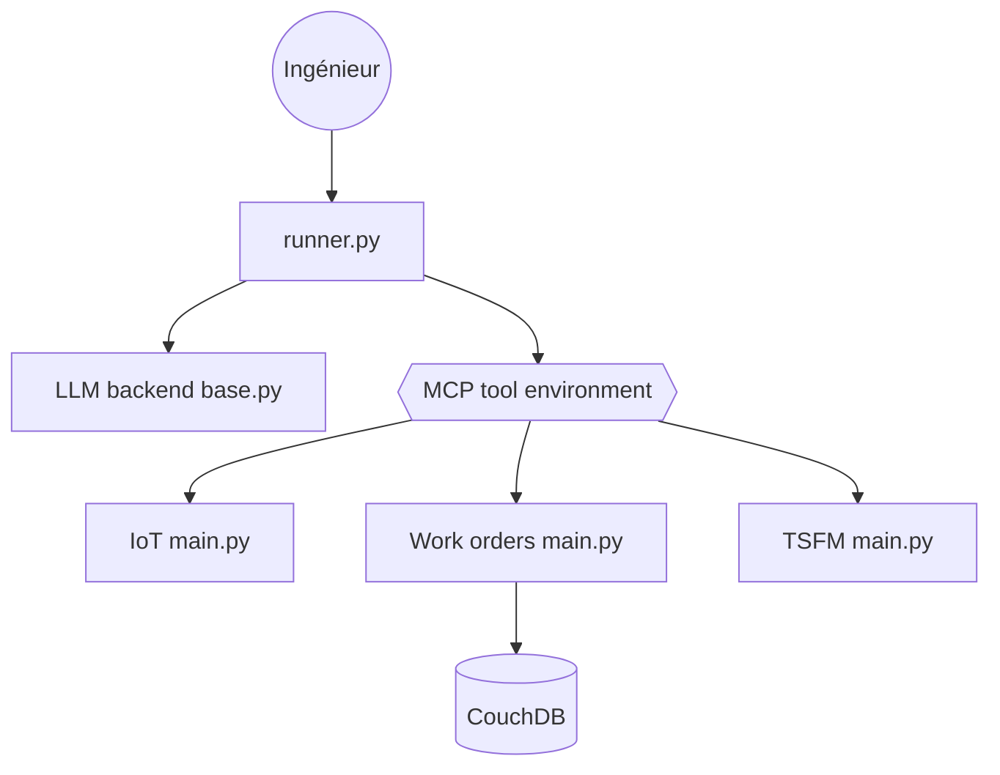

# IBM/AssetOpsBench

> Cadre d'évaluation et d'orchestration d'agents IA pour la maintenance d'équipements industriels.

## Le problème
Il n'existe pas de banc d'essai reproductible pour juger des agents sur des tâches de maintenance : capteurs, ordres de travail, modes de défaillance.

## Ce que ça fait vraiment
Fournit 141 scénarios, six serveurs MCP (IoT, FMSR, TSFM, ordres de travail, vibration, utilitaires) et plusieurs orchestrateurs : Plan Execute, Deep Agent, Claude Agent, OpenAI Agent. Un module d'évaluation note les trajectoires avec un juge LLM. Les données passent par CouchDB.

## Comment c'est branché


## Essayer
```bash
git clone https://github.com/IBM/AssetOpsBench.git
cd AssetOpsBench
pip install -e .
python -m assetopsbench.run --scenario "List all sensors of Chiller 6 in MAIN site"
```
La seconde commande est marquée « à activer » dans le README.

## Coût et pièges
Clé d'API d'un modèle à ta charge. CouchDB est nécessaire pour les serveurs de données. Le classement des modèles est indiqué « à revoir » dans le README. Un mode `AOB_READONLY=1` limite les outils d'ordres de travail à la lecture.

## Ce que ce n'est pas
Pas un produit de maintenance prêt pour l'usine : c'est un banc d'essai en environnement simulé. La branche principale évolue, et les versions des articles vivent sur d'autres branches.

## Alternatives
Aucune citée dans le README.

## Pour toi
À surveiller : référence utile pour évaluer des agents MCP sur des données de séries temporelles, mais surtout pertinente si tu travailles en industrie.

