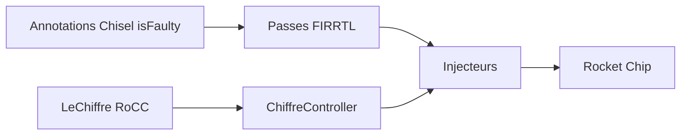

# IBM/chiffre

> Chisel framework for injecting configurable faults into RISC-V hardware designs.

## The problem
Evaluating a circuit's resilience to faults requires instrumenting the design by hand, then driving the injections.

## What it actually does
Three building blocks: a Chisel library that annotates injectable components, FIRRTL passes that add configurable injectors to them, and a runtime tuning tool. Two uses: standalone injection with a custom controller, or Rocket Chip-assisted via a RoCC coprocessor named LeChiffre.

## How it is wired
Simplified diagram based on the fiche, no diagram provided.



## Trying it
```bash
git clone https://github.com/freechipsproject/rocket-chip $ROCKETCHIP_DIR
cd $ROCKETCHIP_DIR
git clone https://github.com/ibm/chiffre chiffre
git apply le-chiffre/patches/rocket-chip-fault-cycle.patch
cd emulator
make CONFIG=LeChiffreConfig ROCKETCHIP_ADDONS="chiffre/le-chiffre chiffre"
```

## Cost and gotchas
Free. Requires Scala/Chisel (absent from the list) and a Rocket Chip clone. Last push in September 2025.

## What it is not
Not an attack tool: it is used to test hardware reliability. It does not apply to software.

## Alternatives
No alternative named in the README.

## For you
Ignore: RISC-V circuit design, far from your data/AI/MLOps work.
