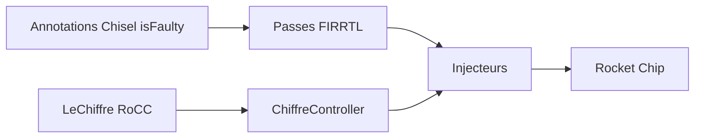

# IBM/chiffre

> Cadre Chisel d'injection de pannes configurables dans des conceptions matérielles RISC-V.

## Le problème
Évaluer la résilience d'un circuit aux pannes demande d'instrumenter la conception à la main, puis de piloter les injections.

## Ce que ça fait vraiment
Trois briques : une bibliothèque Chisel qui annote les composants injectables, des passes FIRRTL qui y ajoutent des injecteurs configurables, un outil de réglage à l'exécution. Deux usages : injection autonome avec un contrôleur maison, ou assistée par Rocket Chip via un coprocesseur RoCC nommé LeChiffre.

## Comment c'est branché
Schéma simplifié d'après la fiche, sans diagramme fourni.



## Essayer
```bash
git clone https://github.com/freechipsproject/rocket-chip $ROCKETCHIP_DIR
cd $ROCKETCHIP_DIR
git clone https://github.com/ibm/chiffre chiffre
git apply le-chiffre/patches/rocket-chip-fault-cycle.patch
cd emulator
make CONFIG=LeChiffreConfig ROCKETCHIP_ADDONS="chiffre/le-chiffre chiffre"
```

## Coût et pièges
Gratuit. Demande Scala/Chisel (absent de la liste) et un clone de Rocket Chip. Dernier push en septembre 2025.

## Ce que ce n'est pas
Pas un outil d'attaque : il sert à tester la fiabilité matérielle. Il ne s'applique pas à du logiciel.

## Alternatives
Aucune alternative nommée dans le README.

## Pour toi
À ignorer : conception de circuits RISC-V, loin de ton travail data/IA/MLOps.

