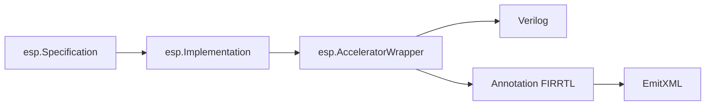

# IBM/esp-chisel-accelerators

> ESP accelerator socket in Chisel3 for writing ESP-compatible hardware accelerators.

## The problem
Plugging an accelerator written in Chisel into the ESP platform requires a precise interface and metadata.

## What it actually does
An `esp.Implementation` conforming to an `esp.Specification` is wrapped by `esp.AcceleratorWrapper`. During Verilog generation, a FIRRTL annotation is emitted, then the `EmitXML` transform produces the XML required by ESP. A single example: `esp.examples.CounterAccelerator`.

## How it is wired
Simplified diagram based on the sheet, no diagram provided.


## Trying it
```bash
sbt run
sbt test
```

## Cost and gotchas
sbt and a Chisel toolchain required (not in the list, hence `none`). Repo archived, last push in 2020.

## What it is not
Not a library of ready-to-use accelerators: a single dummy example.

## Alternatives
None named in the README.

## For you
Ignore: archived since 2020 and focused on hardware design, unrelated to a current data/AI workflow.
