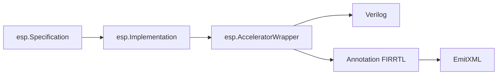

# IBM/esp-chisel-accelerators

> Socket d'accélérateur ESP en Chisel3 pour écrire des accélérateurs matériels compatibles ESP.

## Le problème
Brancher un accélérateur écrit en Chisel sur la plateforme ESP exige une interface et des métadonnées précises.

## Ce que ça fait vraiment
Une implémentation `esp.Implementation` conforme à une `esp.Specification` est enveloppée par `esp.AcceleratorWrapper`. À la génération Verilog, une annotation FIRRTL est émise, puis la transformation `EmitXML` produit le XML requis par ESP. Un seul exemple : `esp.examples.CounterAccelerator`.

## Comment c'est branché
Schéma simplifié d'après la fiche, sans diagramme fourni.


## Essayer
```bash
sbt run
sbt test
```

## Coût et pièges
sbt et une chaîne Chisel requis (hors liste, d'où `aucun`). Dépôt archivé, dernier push en 2020.

## Ce que ce n'est pas
Pas une bibliothèque d'accélérateurs prêts à l'emploi : un seul exemple factice.

## Alternatives
Aucune nommée dans le README.

## Pour toi
À ignorer : archivé depuis 2020 et centré sur la conception matérielle, sans lien avec un flux data/IA courant.

