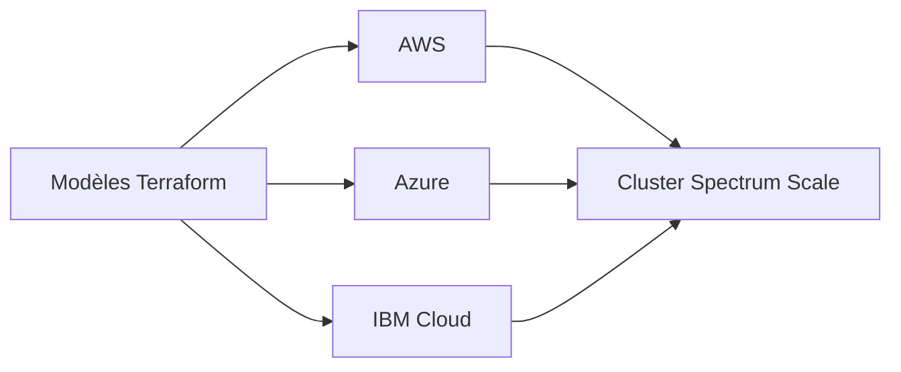

# IBM/ibm-spectrum-scale-cloud-install

> Terraform templates that prepare the cloud infrastructure on which to deploy the IBM Spectrum Scale file system.

## The problem
A shared clustered file system in the cloud requires creating network, instances and storage consistently on each provider.

## What it actually does
The repository provides Terraform templates for AWS, Azure and IBM Cloud, with two architectures: a single availability zone or several. It does not replace the product: it prepares the infrastructure on which Spectrum Scale is installed. The README lists the product's editions.

## How it is wired
Simplified diagram based on the fiche, no diagram provided.

## Trying it
No command documented in the provided README.

## Cost and gotchas
Cloud resources are billed, and the Spectrum Scale product has its own editions. The Developer edition is limited to 12 TB and to non-production use. The README disclaims any liability for costs or data loss.

## What it is not
Not a free file system: it is the infrastructure for an IBM product. The README gives no launch procedure.

## Alternatives
No alternative named in the README.

## For you
Ignore: useful only if your company already uses Spectrum Scale; otherwise the cost and the dependence on IBM are not justified.
