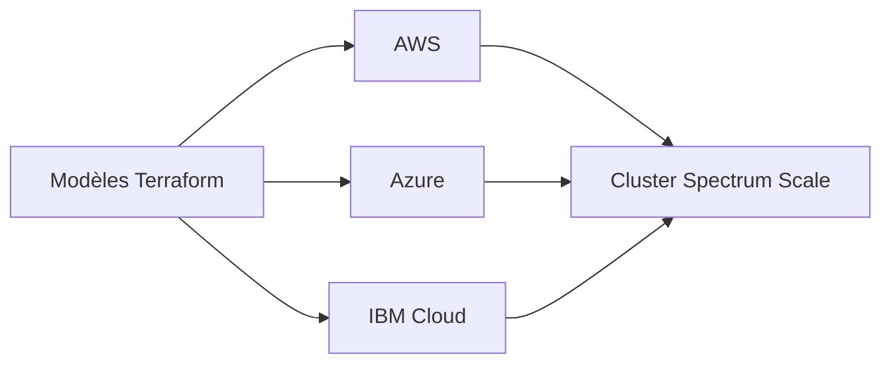

# IBM/ibm-spectrum-scale-cloud-install

> Modèles Terraform qui préparent l'infrastructure cloud où déployer le système de fichiers IBM Spectrum Scale.

## Le problème
Un système de fichiers en cluster partagé dans le cloud demande de créer réseau, instances et stockage de façon cohérente sur chaque fournisseur.

## Ce que ça fait vraiment
Le dépôt fournit des modèles Terraform pour AWS, Azure et IBM Cloud, avec deux architectures : une seule zone de disponibilité ou plusieurs. Il ne remplace pas le produit : il prépare l'infrastructure sur laquelle Spectrum Scale est installé. Le README liste les éditions du produit.

## Comment c'est branché
Schéma simplifié d'après la fiche, sans diagramme fourni.

## Essayer
Aucune commande documentée dans le README fourni.

## Coût et pièges
Les ressources cloud sont facturées, et le produit Spectrum Scale a ses propres éditions. L'édition Developer est limitée à 12 To et à un usage hors production. Le README décline toute responsabilité en cas de coûts ou de perte de données.

## Ce que ce n'est pas
Pas un système de fichiers libre : c'est l'infrastructure pour un produit IBM. Le README ne donne pas de procédure de lancement.

## Alternatives
Aucune alternative nommée dans le README.

## Pour toi
À ignorer : utile seulement si ton entreprise utilise déjà Spectrum Scale, sinon le coût et la dépendance à IBM ne se justifient pas.

