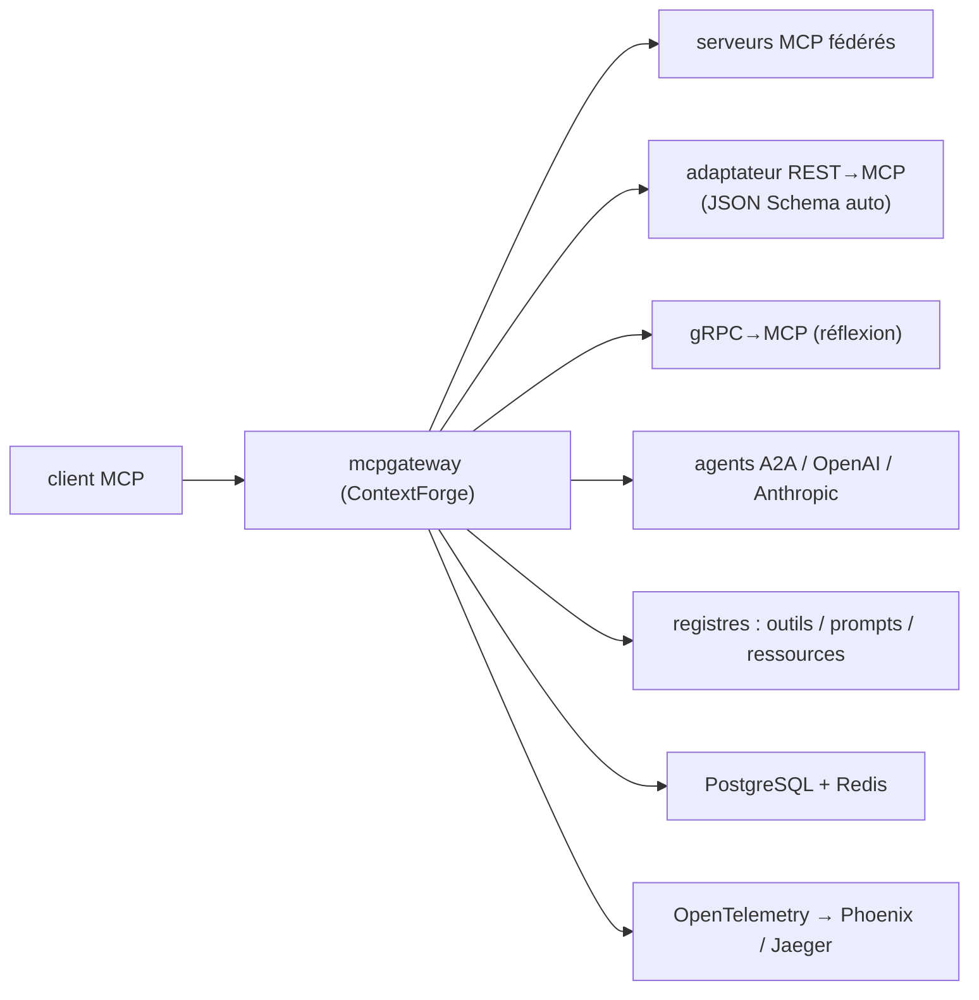

# IBM/mcp-context-forge

> Registry and proxy that federates MCP servers, A2A agents and REST/gRPC APIs behind a single endpoint.

## The problem
Ten MCP servers, three REST APIs and two external agents mean ten sets of authentication,
no shared catalog, no rate limiting and no unified trace of who calls what.

## What it actually does
Federates MCP, A2A and REST/gRPC into a single endpoint, with centralized governance, discovery and
observability. It wraps non-MCP services as virtual MCP servers, automatically extracts the JSON Schema
of REST APIs, and translates gRPC to MCP through the reflection protocol with automatic discovery and
introspection of methods. Three unified registries: prompts (Jinja2 templates, multimodal, versioning
and rollback), resources (URI access, MIME detection, caching, SSE updates), tools (input validation,
concurrency control). Transports: HTTP, JSON-RPC, WebSocket, SSE and streamable HTTP, plus stdio on the
server side. An Admin UI in HTMX/Alpine.js manages configuration and real-time logs, including in
air-gapped deployments. OpenTelemetry tracing to Phoenix, Jaeger, Zipkin, Tempo, DataDog, New Relic,
with token and cost metrics. It itself runs as a compliant MCP server, and scales multi-cluster with Redis.

## How it is wired


## Trying it
```bash
python3 -m mcpgateway.scripts.init_secrets
uvx --from mcp-contextforge-gateway mcpgateway --host 0.0.0.0 --port 4444
pip install mcp-contextforge-gateway
python3 -m mcpgateway.scripts.init_secrets --patch-env .env
export MCPGATEWAY_BEARER_TOKEN=$(python3 -m mcpgateway.utils.create_jwt_token --username admin@example.com --exp 10080 --secret "$JWT_SECRET_KEY")
python3 -m mcpgateway.translate --stdio "uvx mcp-server-git" --expose-sse --expose-streamable-http --port 9000
docker pull ghcr.io/ibm/mcp-context-forge:latest
docker compose up -d
make venv install-dev && make serve
npx -y @modelcontextprotocol/inspector
```

## Cost and gotchas
Free. `JWT_SECRET_KEY` and `AUTH_ENCRYPTION_SECRET` are mandatory **everywhere**, including
locally: without them the gateway refuses to start, and any missing `.env` variable causes an immediate
failure through Pydantic validation. `docker compose up -d` does not build the image locally —
a local build fails on resolving `cryptography`, you have to pull the GHCR image. arm64 is not
supported in production. Helm forces `SSRF_ALLOW_PRIVATE_NETWORKS=false`: registering internal URLs
requires explicitly opening the cluster's CIDRs.

## What it is not
Not a business MCP server: it brings no tools of its own, it federates those of others. Not lightweight:
PostgreSQL with 55+ tables, Redis, nginx, pgAdmin in the Compose stack. Not frozen: the cited version
is a `1.0.0-RC-3`, with a migration guide and a deprecations page. The README is truncated
before the end of the configuration.

## Alternatives
No alternative named: the README only cites MCP Inspector and tracing backends.

## For you
The right answer for the day you have ten MCP servers to govern; oversized before that.
