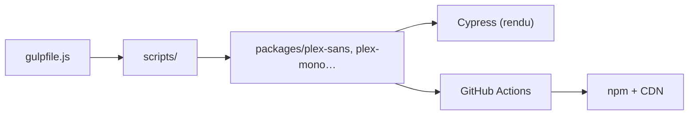

# IBM/plex

> IBM's open source font family (Sans, Serif, Mono, Condensed, Math) under the OFL license.

## The problem
You need a free, complete font, usable in interfaces and in code, with many scripts.

## What it actually does
Monorepo of font packages, one per family: Sans, Serif, Mono, Math and Arabic, Devanagari, Hebrew, Japanese, Korean, Chinese, Thai variants. EOT, OTF, TTF, WOFF, WOFF2 formats plus CSS. Gulp and Node scripts generate CDN, SCSS and zip; Cypress/Percy tests; npm and CDN publishing through GitHub Actions.

## How it is wired

## Trying it
The README gives no command: download the zip from the releases page, or npm packages such as `@ibm/plex-mono`.

## Cost and gotchas
Free. OFL-1.1 license: read the redistribution conditions.

## What it is not
Not a code tool: these are font files.

## Alternatives
For math symbols, the README cites STIX and Cambria as a comparison.

## For you
Useful for dashboards or figures: Plex Mono is also used as a code font; no risk, but no value for ML practice.
