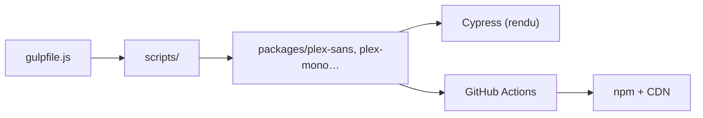

# IBM/plex

> Famille de polices open source d'IBM (Sans, Serif, Mono, Condensed, Math) sous licence OFL.

## Le problème
Il faut une police libre, complète, utilisable en interface et en code, avec de nombreuses écritures.

## Ce que ça fait vraiment
Monorepo de paquets de polices, un par famille : Sans, Serif, Mono, Math et variantes arabe, devanagari, hébreu, japonais, coréen, chinois, thaï. Formats EOT, OTF, TTF, WOFF, WOFF2 plus CSS. Scripts Gulp et Node génèrent CDN, SCSS et zip ; tests Cypress/Percy ; publication npm et CDN par GitHub Actions.

## Comment c'est branché

## Essayer
Le README ne donne pas de commande : téléchargement du zip depuis la page de releases, ou paquets npm comme `@ibm/plex-mono`.

## Coût et pièges
Gratuit. Licence OFL-1.1 : conditions de redistribution à lire.

## Ce que ce n'est pas
Pas un outil de code : ce sont des fichiers de police.

## Alternatives
Pour les symboles mathématiques, le README cite STIX et Cambria comme comparaison.

## Pour toi
Utile pour des tableaux de bord ou des figures : Plex Mono sert d'ailleurs de police de code ; pas de risque, mais pas de valeur pour la pratique ML.

