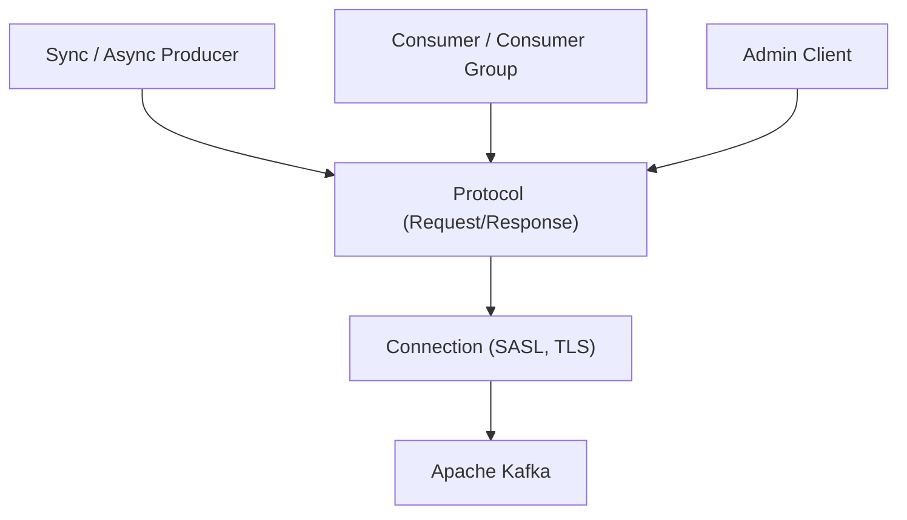

# IBM/sarama

> Go client for Apache Kafka: producers, consumers, groups and administration.

## The problem
Talking to Kafka from Go requires implementing the protocol, security and broker management.

## What it actually does
Provides a synchronous and asynchronous producer, a consumer, consumer groups and an administration client. The protocol layer handles encoding, transactions and versions; the connection layer handles brokers, SASL and TLS. A `mocks` subpackage helps with testing, and the `tools` folder contains command-line tools.

## How it is wired

## Trying it
No command in the README; documentation on pkg.go.dev and the `examples` folder.

## Cost and gotchas
Free. "2 releases + 2 months" guarantee: only the last two versions of Kafka and Go are supported.

## What it is not
Not a Kafka server nor a streaming tool: it is only a Go client.

## Alternatives
No alternative named in the README.

## For you
Adopt if your data or inference pipelines are in Go and talk to Kafka; useless otherwise.
