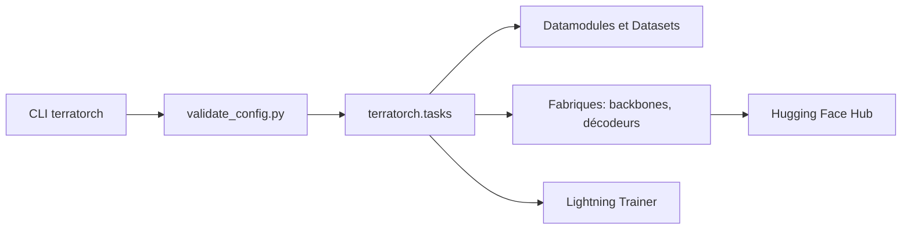

# IBM/terratorch

> PyTorch library for fine-tuning geospatial foundation models, aimed at Earth observation teams.

## The problem
Fine-tuning a foundation model on satellite images forces you to glue backbones, decoders, datasets and the training loop together by hand.

## What it actually does
Lightning tasks (segmentation, classification, pixel-wise regression) driven by a YAML file, CLI or notebook. Factories assemble a backbone (Prithvi, TerraMind, SatMAE, Clay…) and a decoder (SMP, mmsegmentation). TorchGeo and GEO-Bench datamodules are provided. No model is hosted: the weights come from the Hugging Face Hub.

## How it is wired


## Trying it
```bash
pip install terratorch
conda install -c conda-forge gdal
pip install terratorch[peft]
```

## Cost and gotchas
GDAL is mandatory and its installation is described as complex (conda recommended). Extras (vllm, mmseg, wxc on Python ≥ 3.11) are installed separately. The operator must check the license of each downloaded model personally.

## What it is not
Not a model catalog: the README says so in black and white. Not general-purpose: everything is designed for geospatial work. Repository license not declared in the catalog.

## Alternatives
- TorchGeo: the base library, if you only need the datasets and models without the fine-tuning layer.
- Iterate: the HPO/NAS tool cited by the README, for hyperparameter search.

## For you
Worth watching: very useful if you do satellite imagery, but outside the daily work of a generalist data/AI profile, and the license is not declared.
