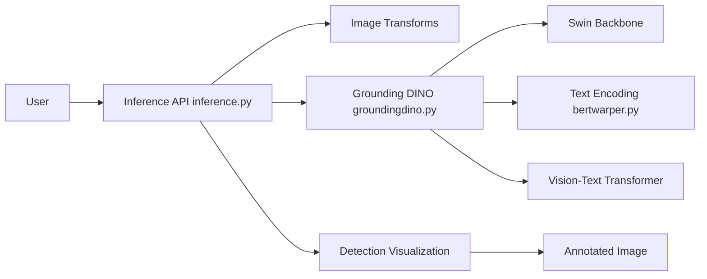

# IDEA-Research/GroundingDINO

> Open-set object detector: an image and a text prompt yield boxes labelled per phrase.

## The problem
Classic detectors only recognise the classes seen during training; annotating a new dataset is expensive.

## What it actually does
Takes an (image, text) pair and returns 900 boxes by default, filtered by `box_threshold` and `text_threshold`.
Architecture: text (BERT) and image (Swin) backbones, a feature enhancer, language-guided query selection, and a cross-modal decoder.
52.5 AP zero-shot on COCO claimed; Swin-T and Swin-B checkpoints; Gradio demo, notebooks with Stable Diffusion and GLIGEN.
Also supported in Hugging Face Transformers. Training code not released.

## How it is wired


## Trying it
```bash
git clone https://github.com/IDEA-Research/GroundingDINO.git
cd GroundingDINO/
pip install -e .
mkdir weights
cd weights
wget -q https://github.com/IDEA-Research/GroundingDINO/releases/download/v0.1.0-alpha/groundingdino_swint_ogc.pth
cd ..
```

## Cost and gotchas
Free. `CUDA_HOME` must be set, otherwise it compiles for CPU and fails with `_C not defined`. Last push August 2024.

## What it is not
Not trainable with this repo (training code not released). Not the latest version: Grounding DINO 1.5 is announced separately.

## Alternatives
- Grounded-SAM / Grounded SAM 2: if you want segmentation and tracking on top of boxes.
- Hugging Face Transformers: to use it without compiling the CUDA extensions.

## For you
Worth watching: very useful for zero-shot pre-annotation of datasets, but go through the Transformers version rather than this repo, frozen since 2024.
