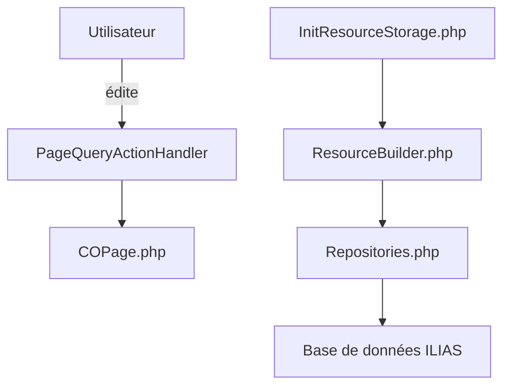

# ILIAS-eLearning/ILIAS

> Free learning management system (LMS) for deploying online training.

## The problem
Institutions need a platform for courses, access and content without paying for a closed solution.

## What it actually does
PHP web application organized in components: content pages, learning modules, forums, access control, accessibility. A ResourceStorage component manages files, revisions and repositories. Extensible through plugins.

## How it is wired


## Trying it
```bash
# Aucune commande dans le README : voir docs/configuration/install.md du dépôt.
```

## Cost and gotchas
Free (GPL 3.0), but you must self-host: web server, PHP and a database. 285 open issues. Detailed installation only in the external docs.

## What it is not
Not an MLOps or training platform: it is a training LMS.

## Alternatives
No alternative named in the README.

## For you
Ignore: useful only if your organization must host its own LMS, which falls outside data and AI.
