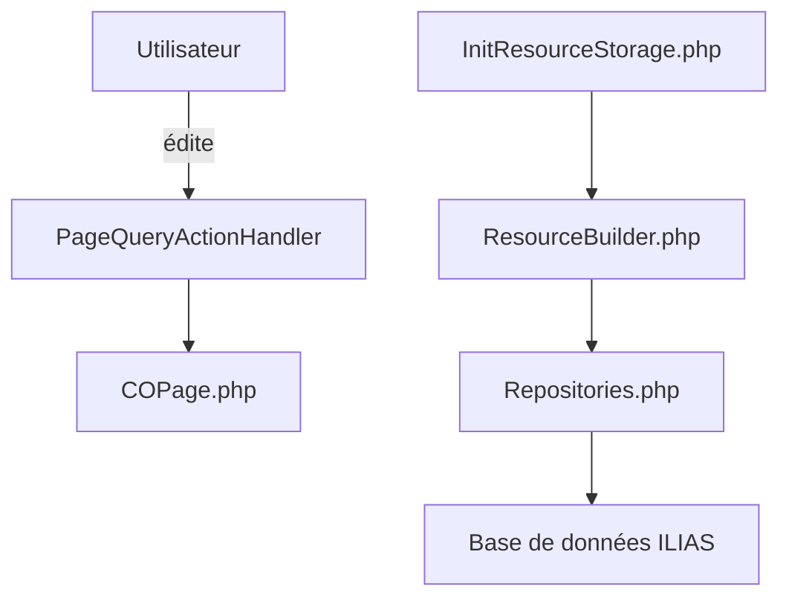

# ILIAS-eLearning/ILIAS

> Plateforme libre de gestion de l'apprentissage (LMS) pour déployer des formations en ligne.

## Le problème
Les établissements ont besoin d'une plateforme de cours, d'accès et de contenus sans payer une solution fermée.

## Ce que ça fait vraiment
Application web PHP organisée en composants : pages de contenu, modules d'apprentissage, forums, contrôle d'accès, accessibilité. Un composant ResourceStorage gère les fichiers, révisions et dépôts. Extensible par plugins.

## Comment c'est branché


## Essayer
```bash
# Aucune commande dans le README : voir docs/configuration/install.md du dépôt.
```

## Coût et pièges
Gratuit (GPL 3.0), mais à héberger toi-même : serveur web, PHP et base de données. 285 issues ouvertes. Installation détaillée seulement dans la doc externe.

## Ce que ce n'est pas
Pas une plateforme de MLOps ni d'entraînement : c'est un LMS de formation.

## Alternatives
Aucune alternative nommée dans le README.

## Pour toi
À ignorer : utile seulement si ton organisation doit héberger son propre LMS, ce qui sort de la data et de l'IA.

